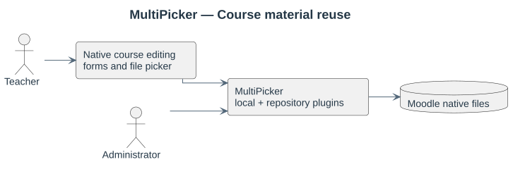
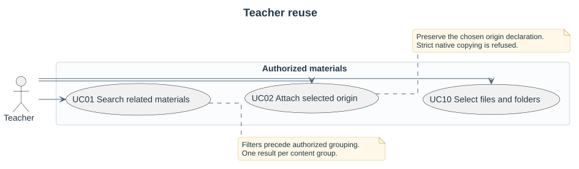
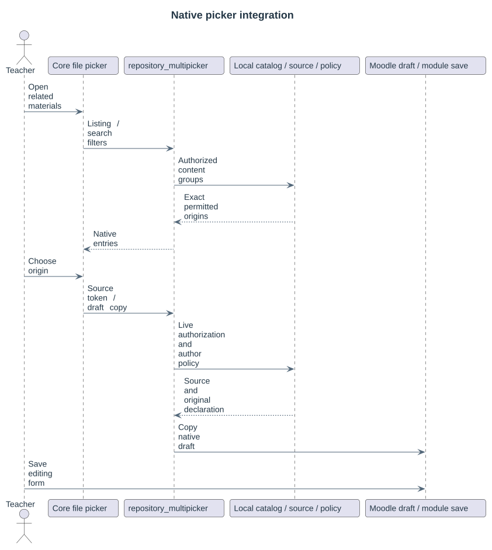
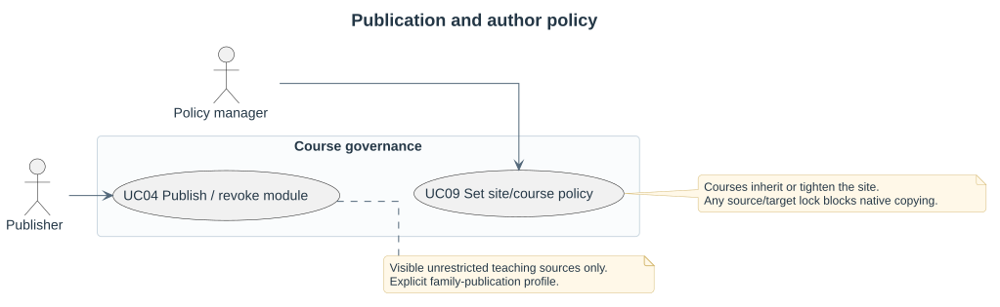
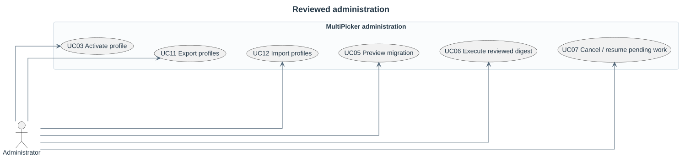

# User workflows

A configurable **family** relates courses. An optional **edition** labels a year, term, cohort or other revision. An **occurrence** is one native file usage; a grouped search result combines identical bytes without merging original author declarations.

## Find and reuse materials

Open a course editing file picker and select **Materials from related courses**. Select a relationship profile, filename, edition, course shortname, activity or file type. Identical content appears once. A grouped entry opens its permitted origins; select the specific source to preserve its author/licence in the new native file.

The course Materials page uses the same authorized catalog with filters, grouped cards and origin tables. Only permitted origins contribute to names and counts. The importing account does not become the declared author.

## Select several files and folders

For several files and folders together, press **Import materials** beside the native Folder/File filemanager. Tick file/folder cards in the embedded picker, review the selection, and import into the current draft. Folder content editors stay on the separate Edit page. Native Save/Cancel and File main-file selection remain in control. See [Folder selection](17-folder-selection.md) and [File selection](18-resource-selection.md).

## Eligible teaching content

Public teaching content means visible, unrestricted course material eligible for the configured reuse policy. It does not mean anonymous web publication. The supported sources are native folder and file-resource content areas. Hidden or restricted courses, sections and modules, aliases, private drafts, submissions, backups and other file areas are excluded.

Source-access-only profiles require current access to the source. Explicit family-publication profiles additionally accept grants on eligible modules. Revocation stops future reuse; existing copies remain independent.

## Review a migration

Select different source and target editions, review the section layout and inspect every file decision. The preview resolves unique course pairs and matching existing folders, preserving source materials and target settings. Execution revalidates the reviewed plan and reports copied, skipped and blocked outcomes.

Site policy and permitted course overrides control author protection. A course inherits or tightens the site policy. Native editors allow later author changes, so strict protection rejects these copies; editable-with-provenance preserves the initial declaration.

The [use-case catalogue](rup/requirements/use-cases/README.md) describes these supported workflows. Custom uploaders that bypass the Repository API are outside this plugin's integration contract.
