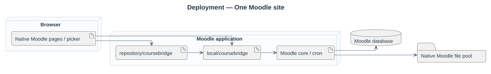
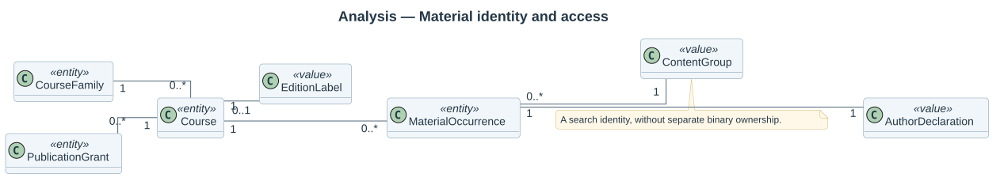
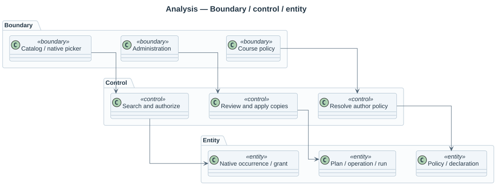
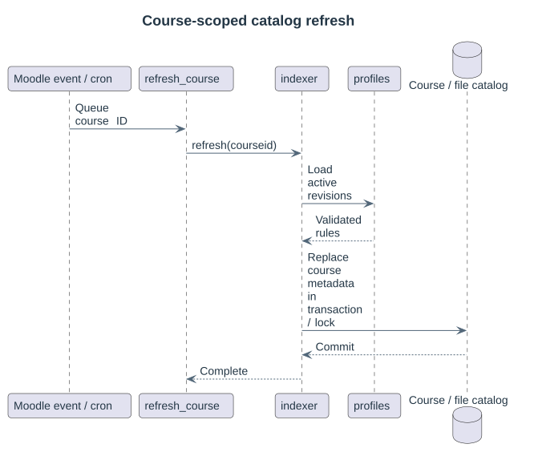

# Architecture

MultiPicker has two components. **local_multipicker** owns data, rules, authorization and administration. **repository_multipicker** owns native picker listing, filters, origin selection and draft copying. It delegates business decisions to the local plugin.

## Domain responsibilities

An asset is a virtual content group. Authorization and author declarations belong to concrete occurrences. Profiles, grants, policies and reviewed migration records have separate identities.

## Current service classes

Services are grouped under `classes/local/catalog`, `profile`, `policy`, `migration`, `selection` and `logging`, with matching PHP namespaces. Administration and course controllers are separate. See the [source structure](13-source-structure.md).

`profiles` activates immutable JSON revisions; `profile_config` resolves generic families, optional editions and pairing dimensions. `indexer` rebuilds per-course metadata, while `catalog` streams candidates and `material_source` checks live visibility, native access or explicit grants.

`migration_planner` resolves course pairs and placements, snapshots each decision and stores the preview digest. `placement` matches sections/modules; `copy_decision` distinguishes byte equality from attribution equality. `migration_executor` revalidates intent under destination locks; `folder_destination` rechecks each destination path and writes through the File API without replacing the entire file area.

`author_policy` resolves site/course/source protection and captures the original declaration. Native editor paths allow later author changes, so strict copying is refused. The repository cannot turn metadata preservation into universal editing prevention.

`material_selection` expands bounded file/folder selections; `draft_import` reviews and applies them to an existing native form draft. The scoped native repository browser consumes this contract; unregistered upload controls keep individual selection. See the [batch service and its sequence](15-draft-batches.md).

`form/scoped_filemanager` inherits the native control and reads its server-defined limits. `draft_scope` binds an explicitly integrated control and its approval to the current session. See the [owning-form API](16-native-form-scope.md); the native activity adapters bind existing authorized controls through the same authority model.

`form/native_filemanager` binds supported live native fields through the public QuickForm element factory. `draft_scope` stores actual limits and review authority; `browser_listing` supplies cards to the embedded browser. `browser_controller` shares bounded state between the embedded page and Moodle Fragment callbacks. `amd/src/browser.js` updates filters/layouts and completes the documented external chooser contract; `editor_import.js` inserts additional approved Tiny links. The companion repository revalidates and transfers reviewed selections through core download. See [Folder selection](17-folder-selection.md) and [File selection](18-resource-selection.md).

## Content and access

Moodle File Storage owns binaries, drafts and native course usages. Identical bytes share native content storage; independent usages retain their native records. MultiPicker adds no binary pool or stored asset table.

The occurrence index is reconstructible. Refresh replaces one course's cached records in a transaction under a lock. Module/course events enqueue refresh work; reconciliation visits up to 100 courses per invocation. Active profile revisions exclude stale membership.

Profile activation also queues revision-bound `task/refresh_profile` work. Each slice examines up to 25 courses, refreshing matches and previously indexed courses before queuing its successor. Obsolete revision tasks exit without rebuilding. Unchanged relationship/scope rules allow membership and capture metadata to move to the new revision immediately; publication and source permissions remain live checks. Changing identity rules deliberately requires fresh metadata, with a pending-update message in an otherwise empty picker.

Every result and selection uses current family membership, course/module/section visibility, availability restrictions and source authority. Tokens and cached locators do not confer access. Ordinary access and explicit family grants follow distinct checks.

Catalog rows are streamed in content order. Filtering and authorization precede grouping; the cursor advances after a complete hash group. Profile and native scope lookups are cached for the request. Destination content hashes are indexed once per target folder during preview.

## Presentation boundary

Page controllers prepare plain data, component renderers select Mustache templates, and the active theme supplies the visual styling. Services do not return presentation HTML. Both plugins expose stable template names and region classes; see [presentation and theme overrides](11-presentation-and-theming.md).

## Lifecycle

The package uses Moodle DML/XMLDB, Task, Lock, capabilities, language strings and Privacy APIs. Native copied files survive plugin removal. Core course backup includes copied files; this package does not remap plugin lineage on restore. Technical actor exports and anonymization remain distinct from material author declarations.

Public activity adapters are described in [public material sources](22-public-material-sources.md). The registry separates enumerating public areas from native read permission and rechecks source eligibility at transfer.

Interactive destination exclusion uses native files directly through `selection/destination_content`: the indexed current-actor draft area is checked by contenthash/filesize before keyset pagination and recursive expansion. Folder selected/remaining totals use one grouped query for all issued page/branch folders, instead of per-folder count queries. No binary duplication or new persistent index/table is introduced. Tree branches use a session-bound Fragment restricted to descendants of issued roots; fetching children preserves the main browser cursor, history and filter state.
