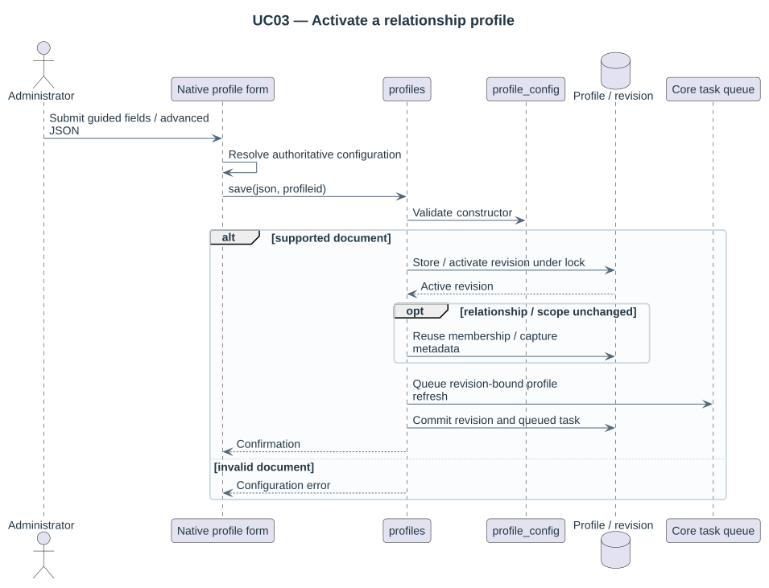

# Configurable course and placement rules

Configure profiles through the guided native form, preview the rules and activate a validated revision. Advanced JSON remains available for rules without a guided control. Saved configurations are data, not PHP, SQL or executable callbacks. Each activation creates an immutable revision; existing migration plans never change meaning silently.



## Course relationship

A parser selects `idnumber`, `shortname` or `fullname` and an anchored delimited PCRE expression with named captures. Required captures, normalization and a family template resolve a course to its family, nullable edition and optional pairing dimensions. Category scope is supported. Trim/case normalizers are explicit; editions stay strings.

All parsers are evaluated; conflicting identities block resolution unless the administrator explicitly selects first-match order. Pattern length, input length and PCRE match/depth work are bounded. Invalid or over-budget expressions fail rather than matching loosely. The supported parser fields are idnumber, shortname and fullname; other parser sources are not accepted.

## Guided profile editor and capture filters

The profile editor opens with Name, Editor, Course identity field, Pattern with named captures and Course group key. Guided fields also expose display templates, optional edition capture, pairing dimensions and category scope. Public-source/publication and folder/section/duplicate rules use collapsed native sections. Search filters are a collapsed repeatable section: each row has a capture name, its display label and an optional-value choice. Add a filter creates another row. Guided editing starts from the server-loaded revision and preserves rules without a form control. Advanced mode retains the complete document and supports multiple parsers and explicit section-map entries. Saving creates an immutable, validated revision. Preview rules reads submitted values without writing a revision.

The Profiles page supports selected/all JSON export and atomic new-profile import through a native upload form. See [administration](20-administration-layout.md) for the portable bundle, limits and site-specific values to review.

Filter keys are stable technical identifiers; labels are independent display names. For example:

```json
"filters": {
  "edition": {"capture": "year", "label": "Academic year", "optional": true},
  "semester": {"capture": "term", "label": "Semester", "optional": false}
}
```

The regex must declare those named captures. The picker generates controls from these definitions, offers up to 100 suggestions drawn only from the currently authorized result page, accepts exact string values and checks current course identities again after querying the index. A profile permits at most twelve filters; empty optional captures do not create indexed values. These search filters do not change family grouping or migration pair dimensions. Old profiles without a filters object expose their existing edition capture automatically.

Names and labels use Moodle `format_string` with the relevant display context, including configured string filters such as Multilang. Names are single-line values, rather than rich descriptions; `format_text` is reserved for rich content. Raw filenames, capture keys, regex patterns and input attributes remain escaped.

## Institutional preset

Actual fields may be:

```text
idnumber = 550e8400-e29b-41d4-a716-446655440000||MAT101||2025
shortname = MAT101||2025
```

The [institutional profile](../examples/institutional-profile.json) parses the full ID number with a UUID family, code and optional four-digit edition. Family grouping uses only the UUID; code is a display/validation dimension; an absent year stays null. Multiple courses with the same family/edition require a configured captured pairing dimension to resolve the pair; ambiguous pairs are blocked.


The [generic preset](../examples/generic-profile.json) groups `BIO101@spring-2026` and `BIO101@autumn-2026` by subject with nonnumeric edition labels. This proves the engine is not tied to annual UUID conventions.

## Module predicates

Select type `folder`, then use exact `name`/`idnumber` comparison or a bounded PCRE predicate. Named source module captures can fill a destination template. `materiales_de_clase.module` is treated as a display name in the institutional preset; change the configured field if it is actually a module ID number. No Moodle ID numbers are rewritten.

## Section matching

Core sections do not have a native `idnumber`. Supported strategies are reviewed ordinal, unique nonempty section name, or explicit mapping of source section ID to destination section ID. A map is course-pair-specific and checked against the destination course, not an assertion that section IDs are portable. Hidden/restricted teaching sources remain ineligible regardless of their match.

## Implemented migration policies

The initial executor supports existing-folder additive copy, same-path identical skip, content/attribution conflict blocking and cross-path duplicate skip/report. Missing or ambiguous destinations block. Relative paths, source content and target visibility are preserved. The executor performs additive copies into existing folders and rejects unsupported policy choices.

## Import workflow

Open Site administration → Plugins → Local plugins → MultiPicker, then the Profiles tab. Create or edit a profile using simple fields and repeatable filters. Advanced JSON remains available for supported custom rules. Refresh affected courses through the course screen, the scheduled reconciler or `cli/reindex.php`; then inspect actual grouped materials before previewing a bulk migration. Source-access-only is the default. To publish historical materials explicitly, select `publication.mode = explicit-family-publication` and grant specific eligible modules.

The package's examples are executable inputs for the current supported subset. `examples/authorship-policy.json` is a configuration explanation, not a relationship-profile import.

## Public source choices

The guided profile editor has a collapsed Public material sources section. Checkboxes activate declared teaching areas, including Assignment handouts and instructions, Page/Book content and public activity introductions. Existing source rules remain opt-in; specific introduction areas configured in advanced JSON survive guided editing. See [source contracts](22-public-material-sources.md).
