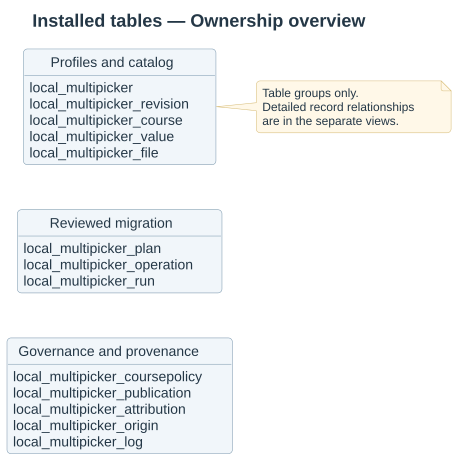
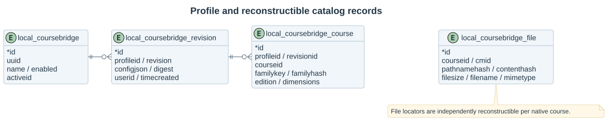
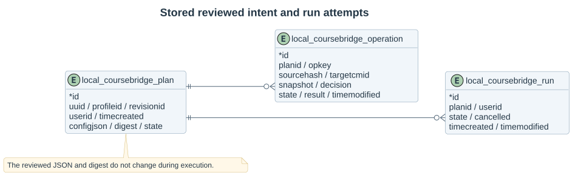
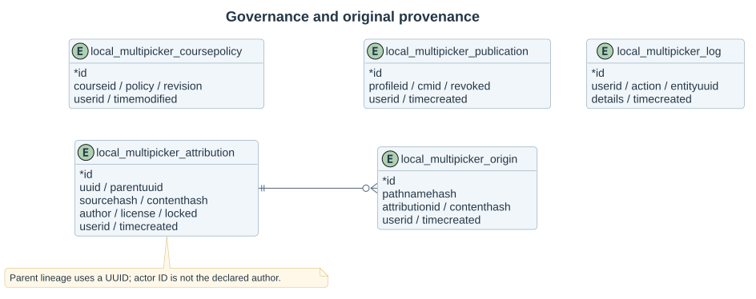
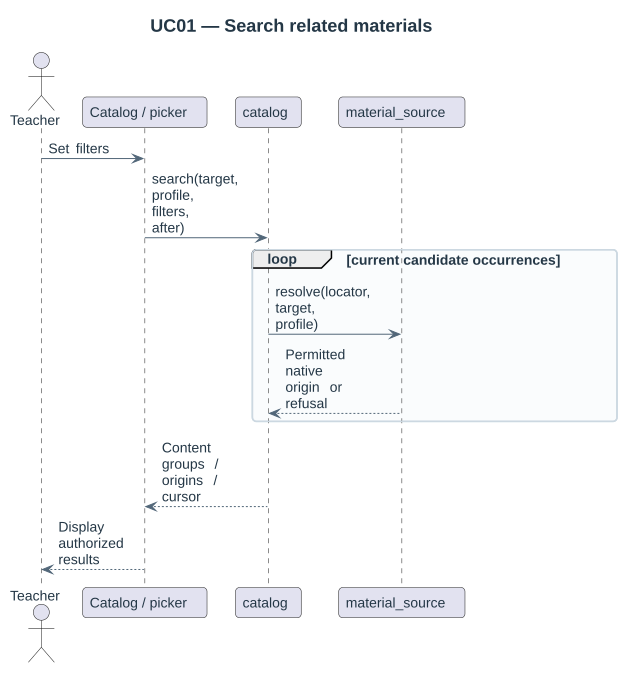

# Database and content identity

All application tables belong to **local_multipicker**. The profile table is named `local_multipicker`; every child table starts with `local_multipicker_`. Moodle adds its configured database prefix at runtime. Use DML placeholders such as `{local_multipicker_plan}`, never hard-code `mdl_`.

The installable schema is [db/install.xml](../db/install.xml). XMLDB foreign-key metadata describes plugin-owned relationships; no business record is owned by a disposable index row. The repository plugin has no installation tables.

`parentuuid` remains a required character field with no declared default. Root attribution records explicitly store an empty parent value; child records store the parent's UUID. Version 2026100802 removes the invalid empty-string XMLDB default without changing those stored values.

## Installed tables

| Table | Purpose and identity |
|---|---|
| `local_multipicker` | Relationship profile; unique UUID, active revision pointer and deleted flag |
| `local_multipicker_revision` | Immutable JSON rules; unique profile/revision; SHA-256 document digest |
| `local_multipicker_course` | Rebuildable membership; unique profile/course; active revision, family key/hash, nullable edition and pair dimensions |
| `local_multipicker_value` | Rebuildable capture values; unique profile/course/key; revision/key/value index for exact filtering |
| `local_multipicker_file` | Rebuildable source occurrence; unique native pathnamehash; course/module, contenthash, size, filename and MIME |
| `local_multipicker_publication` | Explicit module grant; unique profile/module; actor and current revocation flag |
| `local_multipicker_coursepolicy` | Course override; unique course; policy/revision and actor |
| `local_multipicker_attribution` | Original author/license declaration, content/source snapshot and parent lineage UUID |
| `local_multipicker_origin` | Verified destination locator to an attribution record; unique pathnamehash |
| `local_multipicker_plan` | Compact preview specification, operation/selection fingerprints, review digest, profile/revision, actor and state |
| `local_multipicker_operation` | Unique plan/operation key; native source locator, destination module, immutable snapshots/decision, persistent included flag, execution state and structured result |
| `local_multipicker_target` | Unique plan/target key; approved folder definition, created native module and binding snapshot |
| `local_multipicker_run` | Accountable bounded attempt, cancellation flag and outcome |
| `local_multipicker_log` | Scoped actions and outcomes; actor identity removable through Privacy API |

No `local_cb_*` aliases remain. These names fit the XMLDB limits for the required Moodle versions. Binary content, draft areas and native course usages remain in Moodle's own file subsystem.

## Why there is no asset table

A material asset is the virtual key `contenthash + filesize`. Moodle already computes and stores byte identity. A second asset table would duplicate metadata, add joins and require garbage collection without providing publication authority. Group supported occurrence rows in the current query scope; retain each occurrence's own author, filename and source context.

## Distinct deduplication rules

1. Storage deduplication is native Moodle content-addressed storage.
2. Search groups identical permitted filtered content once, retaining the authorized origins.
3. Migration compares destination path, bytes and attribution. New migration configurations skip identical bytes while retaining the destination declaration; legacy strict-attribution plans retain their decisions. Different bytes at the same path require explicit reviewed overwrite permission. Cross-path duplicates follow the migration choice.

Author is declared text, not the importer's account ID. Log and lineage records are separate from rebuildable course/file indexes. Course deletion or reindexing must not erase reviewed plan evidence. Source/target snapshots carry enough native information to detect stale content and placement.

## Indexes and query execution

The action log has composite action/ID and reference/ID indexes. Its reader uses a bounded descending-ID cursor and exact filters without a total-count query. The [log upgrade](12-log-and-upgrade.md) preserves records from the previous table name.

Unique pathnamehash prevents multiple entries for a native occurrence. Membership indexes scope a query to an active revision/family and native course. File indexes cover course/contenthash and module. Plans/operations have deterministic unique keys. Candidate records are streamed in content order; live source/module access is checked before aggregation and origin display. Counts apply only to authorized results.

## Reconstruction and privacy

Course refresh replaces only that course's cache inside a transaction; event delivery gaps are repaired by periodic reconciliation. Current source eligibility wins over a stale row. Durable attribution/plans do not reference the cache by foreign key. Privacy API exports actor-linked governance records and removes actor links; it does not delete other users' native course files.

Version 2026100903 adds the operation `included` flag (default 1) and plan/included/state index. Existing plans retain every operation selected on upgrade; historical decisions and results are preserved.

Version 2026100905 includes the target binding table, operation sourcecourseid/targetcourseid/sourcecmid fields and group indexes, the profile deleted flag, and retention indexes on plan timecreated/id and run planid/state/timemodified. Existing snapshot data backfills operation group fields; reviewed source/target snapshots remain immutable. See [retention](23-history-and-retention.md).
