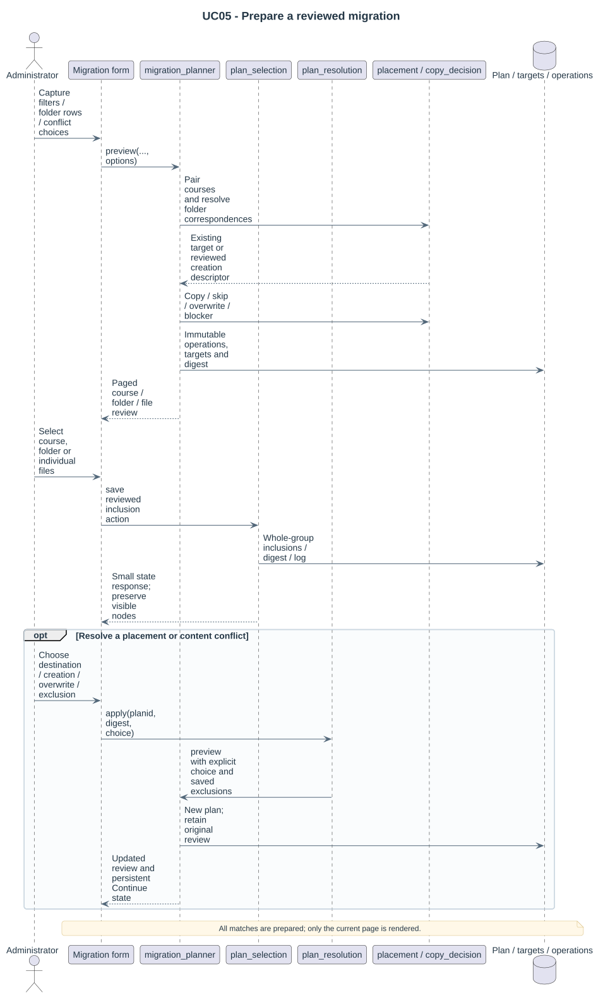

# Reviewed bulk copying

Migrations copy additively into existing folders. They preserve sources, nested paths and destination visibility/settings. Renaming, overwriting or deleting native files, creating sections/folders, compensating a run and correcting declared authors are outside the current package. The [administration screens](20-administration-layout.md) separate configuration, stored review and execution.

## Preview

Choose a profile and distinct source/target edition strings. Pair live courses by configured family and optional dimensions. Require exactly one source and target for each selected pair. Resolve source module predicates by `name` or `idnumber`, then resolve destination sections by reviewed ordinal, unique nonempty name or explicit native-section mapping. **Moodle sections have no native idnumber.**

Select exactly one existing folder in that destination section using its configured predicate/template. Report missing and ambiguous destinations. A course without the selected edition does not become an annual source automatically. Show exact relative paths, authors/licenses and decisions. The [institutional preset](../examples/institutional-profile.json) copies `materiales_de_clase.module` from 2025 to 2026 with explicitly reviewed ordinal layout.

## Decisions

| Condition | Current outcome |
|---|---|
| Absent destination path | Copy if current author policy allows the native workflow |
| Same path, bytes, author and license | Skip identical |
| Same path, different bytes | Block content conflict |
| Same bytes, different declared attribution | Block attribution conflict |
| Same content at another target path | Skip/report according to the supported cross-path policy |
| Missing/ambiguous section or folder | Block the reviewed plan |
| Strict author lock without proven editor integration | Block copying |
| Changed source, identity, placement or protection after review | Block stale operation |

The stored plan includes its immutable JSON digest and rule revision; operations include source/target identity, placement, byte and attribution snapshots. Any blockers prevent queueing that initial plan. Pending blocked operations require a new reviewed preview rather than silent recalculation.

## Execution and concurrency

Queue the exact reviewed digest under the acting administrator's user ID. Use bounded tasks (25 operations per slice), destination module locks, live access checks and current policy. Site maintenance mode and an exclusive administrative editing window are required for folder writes; this is an operational precondition, not a claim that maintenance mode prevents every administrator from editing.

Use the native folder update/draft contract while preserving existing contents and completion date metadata. Before copying, inspect the exact target path again. A crash after native save can be recovered as already present when bytes/author/license match; do not invent deletion provenance for an uncertain already-present file. Course caches/events are refreshed through native APIs.

Draft preparation starts with an empty draft ID so Moodle allocates the area and loads the folder's existing contents. The source is added afterward. A native save keeps unrelated nested files, their existing IDs, contents, authors and licences. The destination adapter also checks effective author policy before draft creation.

Cancel at a safe operation boundary. A new run on an unchanged reviewed plan retries remaining pending operations; completed effects stay intact. Per-item failures are recorded and unaffected operations continue. Source files and unrelated target files are never removed.
