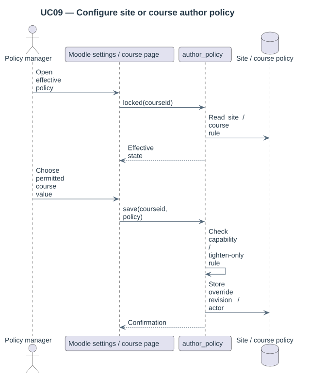

# Author metadata and site/course policy

The selected occurrence supplies its declared `author` and `license`. The importing teacher and technical uploader are action actors. CourseBridge does not infer authorship from their accounts or rewrite authors embedded in document contents.

## Settings

| Setting | Values |
|---|---|
| `author_policy` | `preserve_locked` (default), `editable_with_provenance` |
| `author_course_override` | `disabled` (default), `tighten_only` |
| `author_missing_policy` | `preserve_unknown` (default), `block_reuse` |

The course Material policy page displays the effective policy and, when permitted, offers inheritance or a stricter lock. A course cannot weaken the site. Protected source provenance, source-course policy and destination-course policy combine: any lock requires protection.

## Native copying behavior

| Workflow | Author/licence behavior |
|---|---|
| Picker selection into a native draft | Source values are preserved; caller-submitted author values are ignored |
| Reviewed folder copy | Source values are preserved through native folder save and checked afterward |
| Any strict source/destination protection | Copy refused because subsequent native editor protection is unavailable |
| Editable source and destination | Initial declaration captured; later native editor changes permitted |
| Missing author with `block_reuse` | Copy refused; importer identity is never substituted |

These two plugins do not prevent every later native author change. The strict default refuses unsupported copying rather than claiming a lock. Editable-with-provenance must be chosen explicitly by an administrator.

## Original provenance

Attribution records store the source declaration, native locator/content hash and parent UUID. Verified migration destinations are bound to those records. Picker drafts carry the attribution UUID in their native source metadata.

Identical bytes can have different names and authors across origins. Search retains those declarations on separate origin rows; migration blocks identical-byte targets with conflicting author/licence metadata.

Privacy operations export and anonymize action actors independently of declared material metadata. This package exposes no correction/propagation action and does not remap plugin lineage on backup restore.
