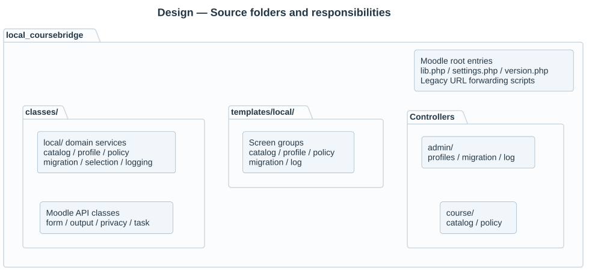

# Source structure

Moodle discovers plugin metadata, callbacks and repository entry classes at their standard locations. Those entry files stay at the plugin root. Business services use namespaced subdirectories under `classes/local/`; the directory and namespace match.

## Local plugin layout

```text
local/multipicker/
├── admin/                  settings.php, profiles.php, profile.php, migration.php, migration_review.php, log.php
├── course/                 index.php, policy.php
├── classes/
│   ├── local/
│   │   ├── catalog/        catalog, indexer, material_source, source_provider, native_source_provider, source_registry
│   │   ├── profile/        profiles, profile_config
│   │   ├── policy/         author_policy
│   │   ├── migration/      planner, executor, placement, folder adapter, decisions
│   │   ├── selection/      material_selection, draft_import, draft_scope, browser_controller, browser_listing, selection_basket, destination_access, native_integration, selection_options
│   │   └── logging/        log
│   ├── form/               native Moodle forms, scoped_filemanager, native_filemanager, native_editor integration elements
│   ├── output/             view, renderer, display, navigation, profile_summary, migration_report
│   ├── privacy/            Moodle Privacy API provider
│   └── task/               Moodle task entry classes
├── templates/local/
│   ├── catalog/            index, filters, material_card, publication
│   ├── profile/            list, summary
│   ├── navigation/         tabs
│   ├── policy/             course
│   ├── migration/          setup, report
│   ├── selection/          review
│   └── log/                index
├── db/                     schema, upgrades, capabilities, task/event definitions
├── cli/                    reindex.php
└── lib.php, settings.php, version.php
```



For example, `classes/local/catalog/indexer.php` defines `local_multipicker\\local\\catalog\\indexer`. Cross-domain dependencies use explicit imports. The root observer, task class names and Privacy API provider retain their Moodle entry contracts.

## Page routes

| Purpose | Canonical route |
|---|---|
| Course catalog | `/local/multipicker/course/index.php` |
| Course policy | `/local/multipicker/course/policy.php` |
| Site settings | `/local/multipicker/admin/settings.php` |
| Relationship profiles | `/local/multipicker/admin/profiles.php` |
| Profile editor and unsaved preview | `/local/multipicker/admin/profile.php` |
| Portable profile import | `/local/multipicker/admin/profile_import.php` |
| Migration administration | `/local/multipicker/admin/migration.php` |
| Stored migration review and execution | `/local/multipicker/admin/migration_review.php?planid=...` |
| Action log | `/local/multipicker/admin/log.php` |

The five previous root page URLs remain authenticated forwarding entry scripts. They include the actual controller, preserving request parameters and POST handling. Controllers retain their course/system capability and session-key checks. New navigation links and form actions use the canonical routes.

## Templates and theme overrides

Templates use a `local/` first subdirectory, following Moodle's component namespace rules. `output/view` maps approved logical names to the organized identifiers documented in [presentation](11-presentation-and-theming.md), including navigation, the browser/review/review_node, rule summaries and the migration setup/review screens.

Existing custom theme overrides must use the new paths, for example:

```text
theme/mytheme/templates/local_multipicker/local/catalog/material_card.mustache
```

Replace the plugin code as a complete package so removed class/template files do not remain as stale copies, then run Moodle's normal plugin upgrade and cache purge. Business table names and stored task class names are unchanged.

References: [Moodle templates and subdirectories](https://moodledev.io/docs/4.5/guides/templates), [autoloaded common files](https://moodledev.io/docs/4.5/apis/commonfiles).


`selection/index.php` owns browsing, `selection/review.php` owns review, and `selection/status.php` returns an actor-bound completed-editor receipt. `lib.php` exposes the authenticated native Fragment callback. AMD browser/editor_import modules contain presentation and public native chooser/editor coordination; their core-generated assets live in `amd/build`.

Guided profile rules and JSON transport belong to `local/profile/guided_config.php` and `profile_bundle.php`. Migration capture scopes and persisted selection belong to `local/migration/course_scope.php` and `plan_selection.php`. `admin/profile_import.php` uses `form/profile_import_form.php`. The small `administration` AMD module synchronizes page checkboxes; PHP remains the authority for all changes.

Migration-owned rows are validated by local/migration/migration_rules; created native folders bind through target_binding. form/row_data and amd/src/row_editor.js provide bounded editable tables for captures, correspondences and section maps. local/maintenance/retention and task/clean_history manage indexed history expiration. admin/migration_list.php renders the permission-checked migration history within the canonical migration entry.

`amd/src/review.js` opens the native Save/Cancel filename modal. `browser.js` refreshes only result nodes and keeps live filters enabled; `browser_listing::select_all` resolves every filtered page with the same source authority and batch limits. The embedded heading comes from the server-bound native repository instance name.

`classes/task/refresh_profile.php` reconciles an activated profile through revision-bound 25-course slices. `profiles::save` queues that work transactionally and reuses current membership for unchanged relationship/scope rules. Event-driven course tasks and periodic reconciliation remain independent catalogue refresh paths.

Profile comparison, restoration and bounded version expiration belong to local/profile/profile_history. admin/profile_history.php renders templates/local/profile/history with 25-version pages. local/migration/plan_history validates inactive-history deletion and whether an included plan contains actual writes. local/selection/selection_limits computes the native field capacity before any recursive selection is persisted.
