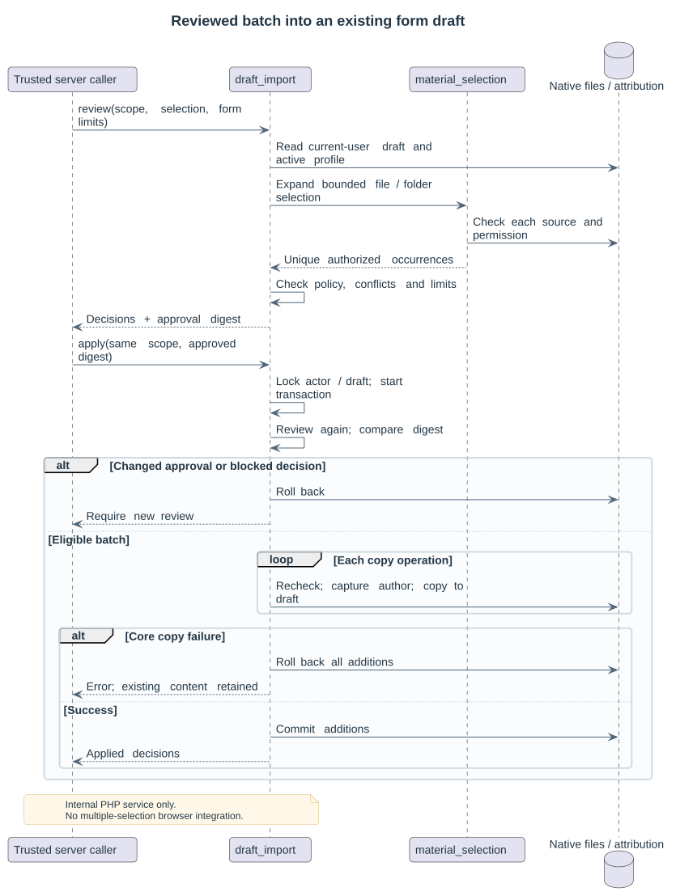

# Reviewed draft batches

The internal PHP services in `classes/local/selection/` resolve mixed file/folder selections and copy a reviewed batch into an existing, current-user native draft. They do not expose a web endpoint or add multiple selection to the repository dialog. The current native picker still selects one file at a time.

Explicitly integrated native controls use [the owning-form scope API](16-native-form-scope.md) to bind their real options and reviewed selectors to the current session. Direct PHP callers still own their authoritative form contract.

The [Folder Settings consumer](17-folder-selection.md) provides native mixed selection, review and form rerendering over these services. The service itself does not own the screen or permanent module saving.

## Selection and destination

`material_selection::resolve()` accepts explicit native file occurrences (`pathnamehash`) and folder-module directories (`cmid`, `filepath`). A folder selects its files recursively. Parent/child/file overlaps are deduplicated by pathname hash. Empty folders, invalid paths and selections exceeding 200 files are rejected. SQL wildcard characters in directory names are literal. Only eligible native folder/resource teaching files are accepted, with current family, source visibility, access or explicit publication checks for each file.

`draft_import::review()` requires target reuse and activity-management capabilities. The draft destination directory must already exist in the current account's draft area. Source paths are merged below that directory: source `/notes/lesson.txt` copied at destination `/materials/` becomes `/materials/notes/lesson.txt`. Source module display names do not create additional directories; empty directories are not copied.

The caller supplies the owning form's actual server-side `maxfiles`, `maxbytes`, `areamaxbytes`, `subdirs` and `accepted_types`. Incomplete contracts are rejected. Browser-supplied values cannot establish this authority. A control with `maxfiles = 1` cannot receive a batch resulting in several files. Native conventions apply: `maxfiles = -1` and `areamaxbytes = -1` are unlimited; `maxbytes = 0` is unlimited after the caller has resolved the applicable form/site/course limit.

## Review and application

Review writes neither files nor attribution records. Each operation reports its concrete source, destination path and decision: `copy`, `skip_identical`, `skip_content`, `blocked_content` or `blocked_attribution`. Same-path conflicts never overwrite existing files. Configured cross-path content skipping also checks the declared author and licence. Existing files contribute to the destination count and byte limits.

The returned SHA-256 digest includes the actor, course, profile revision, draft, destination directory, control options, existing draft snapshots and reviewed operations. `apply()` requires that approved digest, locks this actor/draft for CourseBridge, recomputes the review and refuses changed or blocked decisions. The digest detects stale approval; it is not an authentication token. A web caller remains responsible for authentication, session protection and binding the owning form to the course, draft and authoritative limits.

During application, each copied source is resolved and its policy and snapshot checked again. Native File API copies preserve each author/licence and carry the serialized provenance marker expected by Moodle draft saving. Files and attribution additions share a delegated database transaction. A core error rolls back the new records while retaining existing draft files. This lock coordinates CourseBridge batches; native uploads and unrelated core editors do not share it.

The normal owning form performs permanent saving. Tests exercise native folder saving and preservation of original declarations and markers. The service does not save an activity independently or refresh a browser filemanager.

## Author protection and validation

The strict site/course author policy still refuses native copies because later native metadata edits cannot be universally prevented. Explicit editable policy preserves the original declaration in provenance; it does not prohibit later editing. See [authorship](09-authorship-policy.md).

Integration tests cover mixed overlapping selections, multiple source folders, content skipping, conflicts, destination limits, draft ownership, hidden sources, changed drafts/profiles/policies and rollback after a second-copy failure. Exact core results are recorded in [validation](07-validation-and-decisions.md). No tables or new browser endpoints are introduced.

