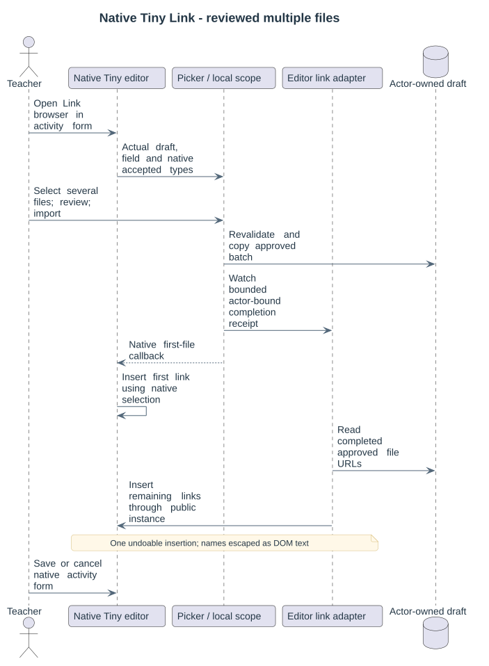

# Visual folder and file selection

Open **Add files** in the native Folder filemanager and select the configured repository name in the repository sidebar. The browser stays inside Moodle's picker. This entry works in Folder **Edit** content, activity **Settings**, and new activity forms. There is no second import button or additional activity tab.

1. The **Source activity** filter initially matches the destination activity. Choose All to reuse other public activity materials. File name, file type and the first two profile-defined capture filters appear together; secondary filters and copy placement remain in **More filters and copy options**.
2. Search updates after a short typing delay; selects update immediately through Moodle's Fragment API. The original filter controls stay enabled in the same DOM nodes, preserving focus, caret and ongoing typing. Only result cards/list reload; stale responses do not overwrite newer filters. The modal keeps its dimensions during loading. Cards/List buttons change the actual result layout.
3. Tick file or folder cards. The arrow button opens a folder; Back returns to its parent. Selection survives filtering, folder navigation and result pages. **Select all** resolves all matching result pages and expands folders into actual files; **Clear selection** clears the complete selection. The native field and 200-source batch limits still apply, with an explicit rejection rather than silently truncating an oversized selection. Folder checks show complete or partial selection and a selected/total badge, including when navigating into a selected directory.
4. **Review selection** opens a separate page within the same modal. A collapsible folder tree shows destination paths, original author/licence and Copy/Skip/Blocked decisions. Filenames are readable text. A native pencil action opens a Save/Cancel modal for renaming one file. Red remove actions and bulk removal operate on resulting files. Saving changes rebuilds approval; Back returns to the checks and chosen layout. Review copies no files.
5. **Import reviewed materials** transfers an approved batch through Moodle's protected repository download. The original filemanager refreshes, leaving pending native fields intact.
6. Save or cancel using Moodle's ordinary form buttons. Cancel leaves permanent activity content unchanged; abandoned drafts use normal Moodle cleanup.

## Folder structure and duplicates

A folder checkbox denotes the complete eligible descendant tree, including files outside the current search. Filename/type searches show individual files instead of whole-folder shortcuts. Empty directories are not transferred. Each batch resolves at most 200 source occurrences; overlapping parent, child and file selections resolve each occurrence once.

| Folder structure | Selected /notes/ containing /notes/week1/lesson.txt |
|---|---|
| Keep original paths | /notes/week1/lesson.txt |
| Include the selected folder | /notes/week1/lesson.txt |
| Copy only its contents | /week1/lesson.txt |

Selecting an activity root with Include the selected folder uses its cleaned activity name as the enclosing directory. The widest selected parent determines overlapping placement. An existing destination directory prefixes these paths. Changing placement, profile or items invalidates approval; changed sources, drafts or deleted destinations require another review.

Each content page is bounded to 50 groups with Next/Previous cursors. File results group identical bytes while retaining an authorized occurrence and its declaration. Source capture/course filters choose the desired origin. Folder cards always describe real Folder content directories. Equal content/declarations are skipped according to the supported copy policy; conflicting paths, bytes or declarations block copying instead of overwriting.

## Native integration and permissions

The after_config hook registers inherited native filemanager and editor elements through Moodle's public QuickForm factory on /mod/folder/edit.php and /course/modedit.php. Native fields supply context, actor-owned draft, accepted types and count/byte/directory limits. Empty existing drafts receive their own root before binding. Browser parameters cannot create authority or override limits.

Folder content editors require mod/folder:managefiles, local/multipicker:browse, local/multipicker:reuse and repository access. They do not need moodle/course:manageactivities. Other activity settings/new forms retain their actual native editing permission. Custom roles need the MultiPicker capabilities explicitly.

Supported Tiny activity editors use the same picker. Tiny's native Link browser inserts the first link and the local adapter adds remaining approved links through the public editor instance, in one undoable insertion. Image/media subpickers retain one-file selection and their native accepted types. Editors without a verified multi-link adapter and unregistered controls retain their ordinary native behavior. No student submission or private profile form is automatically batch-enabled.

See [public source areas](22-public-material-sources.md), [author policy](09-authorship-policy.md), [scope binding](16-native-form-scope.md), [File main-file behavior](18-resource-selection.md) and [validation](07-validation-and-decisions.md).

The compact browser selects by clicking a card body or its checkbox/label. Folder navigation buttons do not toggle selection. Folder views place course/path context beside Back; the selection list is displayed on the separate review screen. Compact automatic filter inputs, native MIME icons, small folder arrows and Cards/List layouts share the theme palette.

The embedded surface follows the native repository background. Filters and bottom actions stay fixed while only results scroll. Every automatic result load displays light skeleton placeholders only in the result area. The review counts resolved files, retains the folder tree and does not repeat a selected-material basket. The user-supplied plugin icon is shared by both components; other controls use core icons.
