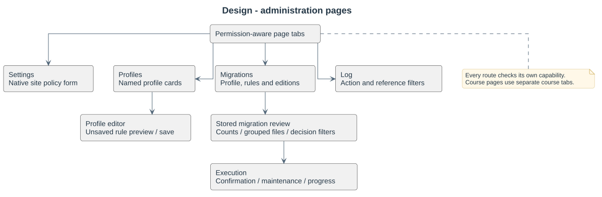
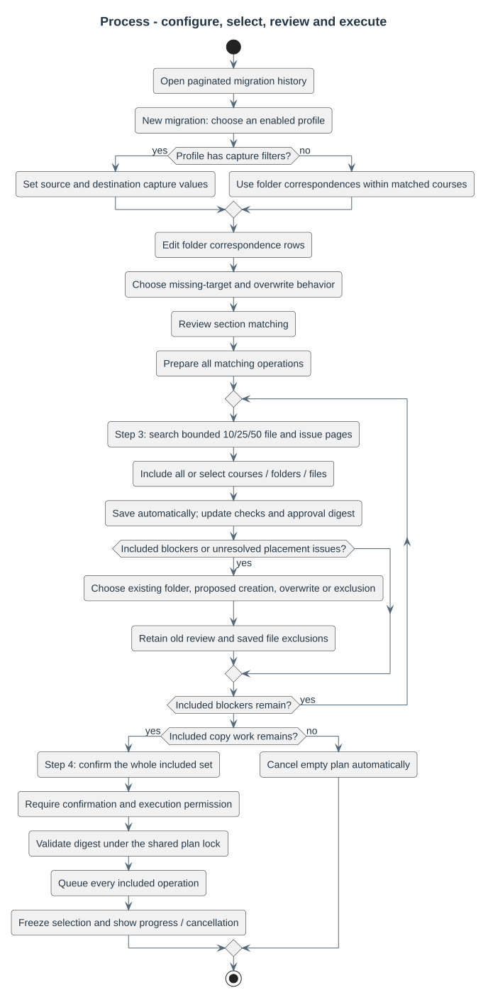

# Administration and review screens

Open Site administration > Plugins > Local plugins > MultiPicker. Settings, Profiles, Migrations and Log are native, permission-aware secondary navigation. Each route checks its capability. Delegated profile managers have an entry without site settings access. Log also appears under Site administration > Reports > MultiPicker material reuse.

## Settings and profiles

The native settings form controls author policy, course overrides, missing-author handling and independent log, migration and profile-version retention periods. Zero disables the corresponding expiration.

Profiles use a searchable table of twenty-five rows per page. Name opens the editor; status, grouping key, capture labels, current version and date help distinguish profiles. Native right-hand actions edit, enable, disable or delete a row. Bulk selection enables, disables, deletes or exports selected profiles; Export all and Import profiles are separate actions. Deletion removes the profile from normal use while retaining referenced revisions/history. Active migrations prevent a profile lifecycle change.

The guided editor uses ordinary fields and an editable filter table. Advanced rules replace the guided sections. There is no separate edition section or migration folder configuration. See [profile configuration](04-configurable-rules.md).

Import accepts an exported JSON bundle or a single profile through the native upload form, with limits of 500 profiles, 5,000 historical versions and 16 MB. Validation completes before writes; each imported profile has a new identity and retains the exported version numbers, dates, enabled state and current configuration. Native files, logs, database IDs and author history are not exported. Category and section IDs in legacy advanced documents remain site-specific.

## Migrations

The initial table shows migration reference, profile, status, date and clickable references and profile names, with twenty-five rows per page. Search and a top-right Filters control narrow the history. New migration opens the wizard:

1. Choose an enabled grouping profile.
2. Configure its source/destination capture values and editable folder correspondences. Without captures, only correspondences and placement choices appear.
3. Review collapsible course/folder groups and fifty-file pages; search, decision filters and persistent checkboxes choose the complete included set. Change configuration opens a new review without altering the stored plan.
4. Execute the approved whole set without site maintenance; follow progress and cancel at a safe boundary.

Course/folder actions include their off-page files. Whole-plan actions cover every matching operation. Individual exclusions remain after searching and navigation. JavaScript saves changed file checks before paging or moving to execution; without it, Save selection persists those changes. Informational missing-source notices do not block unrelated files. Ambiguous placement and included blocking decisions still prevent execution.

## Logs and native presentation

Log uses a compact table and top-right Filters disclosure for action, reference and date bounds. Pagination uses a descending-ID cursor. Date bounds use the reader's timezone and include the whole final day. Structured internal details stay undisplayed.

The PHP navigation delegates rendering to each exact core: Moodle 4.5 uses core/moremenu; the Moodle 5.3 distribution uses core/secondarymoremenu and its native React navigation. Forms, buttons, tables, icon rendering and validation remain owned by Moodle/the active theme. Custom disclosures use core chevrons. Templates remain overrideable under local/navigation, local/profile, local/migration, local/catalog and local/log.

Page actions occupy the upper toolbar/form action group. Profile export/enable/disable/delete actions appear beside Select all only while a selection exists. They start hidden and disabled, and return to that state when the last row is cleared. Each action is a compact core icon button with a translated tooltip and accessible label; delete has a destructive colour. Profile row actions use the same grouped presentation. The layout follows the grouping pattern of Didactika ServiceManager while rendering Moodle core icons.

Migration review groups Include all, Exclude all and Save selection as labelled icon buttons above the course groups. Whole-plan actions remain available when no files are included, so an entirely excluded plan can be included again. Their scope includes off-page operations; searches and pagination do not limit the approved set.

Blocked migration rows offer Edit. Inactive migrations offer a Delete icon that removes history while retaining copied files and attribution. All rows use clickable references and names. The action column is omitted on pages without additional actions. Editing creates a new plan rather than rewriting a previously reviewed or executed one.

The Current version link and editor Version history action open [paginated version history](25-profile-version-history.md), with a field-by-field comparator and native restoration action. A plan without included copy or overwrite operations is cancelled automatically; informational skips remain visible.
