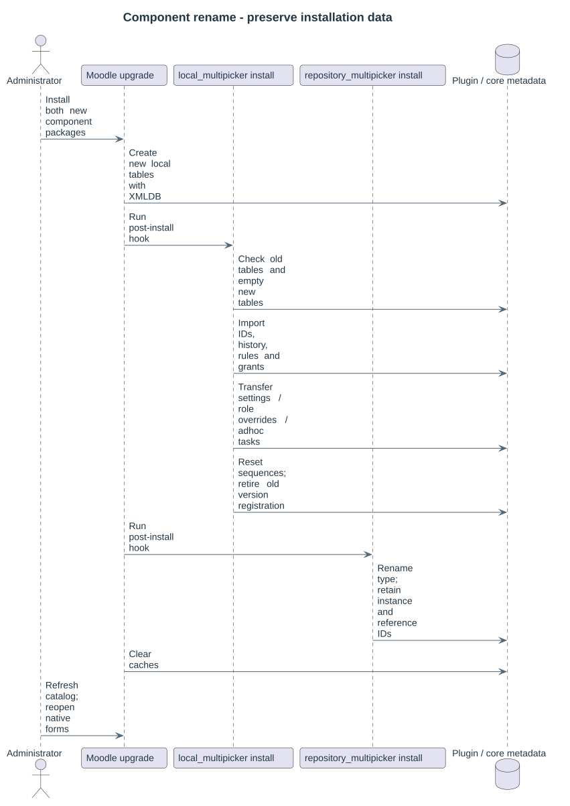

# Component rename from CourseBridge

The current components are **local_multipicker** and **repository_multipicker**, installed at `local/multipicker` and `repository/multipicker`. Each component remains a standalone Git repository. All fourteen business tables use the `local_multipicker` prefix; the repository owns no business tables.

## Existing installation

1. Upgrade an existing CourseBridge installation to version 2026100901 before replacing it. Keep a database and code backup; deploy during the usual Moodle maintenance window.
2. Move both legacy code directories outside the Moodle application directory. Install both new packages into the MultiPicker paths. Do not run Moodle's legacy plugin uninstall routine before importing its data.
3. Run Moodle's plugin installation/upgrade. The local post-install hook imports all twelve legacy tables, preserving record IDs, profile revisions, publication grants, author history, plans and log records. It refuses to combine populated old and new installations. XMLDB sequences are reset after import.
4. Site settings and explicit local/repository capability overrides are transferred. Pending local adhoc tasks adopt their new component/class names; legacy scheduled tasks are disabled. The repository post-install hook changes the existing repository type name while keeping its ID, instances and file-reference associations.
5. Moodle clears caches after installation. Refresh the material index with cron or `local/multipicker/cli/reindex.php` to populate the capture-value index. Reopen native forms so new scoped drafts and approvals belong to the current components.

The old component version registration is retired after a successful import. Legacy tables and settings remain as rollback data; current MultiPicker services never write to them. Native `files` records and module content areas are unchanged. Previously stored source declarations retain their original markers and attribution UUIDs. A stored migration preview may need to be recreated when its identity snapshot predates configurable capture filters; execution rechecks the current contract and fails closed if it differs.

## Fresh installation

When no legacy profile table exists, the local installation hook does nothing. XMLDB installs the new schema normally. The repository hook also does nothing when no legacy repository type exists. Required core layouts and maintenance lines are described in [compatibility](10-compatibility-and-branches.md).
