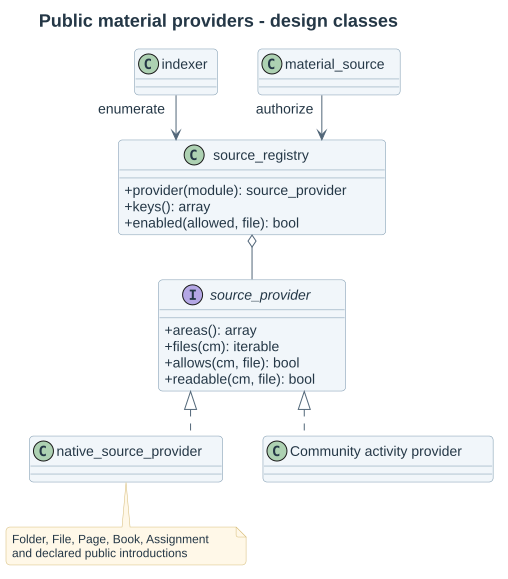

# Public activity materials

The catalog contains declared teaching files, rather than every file stored under a course context. In the guided profile editor, expand **Public material sources** and tick the source areas to enable. Advanced JSON uses publication.allowed_sources. Existing profiles retain their allowlists when upgraded; installing adapters does not silently publish more content.

| Activity | Declared areas | Additional live condition |
|---|---|---|
| Folder | mod_folder/content | Native readable Folder content |
| File | mod_resource/content | Native readable supporting/main files |
| Page | mod_page/content | Native Page content access |
| Book | mod_book/chapter | Visible chapter belonging to that Book; mod/book:read |
| Assignment | mod_assign/introattachment | Additional teaching files; exact core attachment visibility |
| Assignment | mod_assign/activityattachment | Activity instructions must currently be displayed |
| Installed activities declaring FEATURE_MOD_INTRO | mod_*/intro, or a specific mod_name/intro | Native public activity introduction, itemid zero |

Assignment submissions, feedback components, Forum post attachments, user-private areas and undeclared file areas are excluded. Hidden/restricted courses, modules and sections are rejected before source access or explicit family publication is considered. Folder intro files are individual files, separate from the folder's content tree.

Moodle 4.5's Assignment attachment serving respects show_intro(). The exact Moodle 5.3 checkout permits introattachment through native assignment view access even before timed instructions; activityattachment still respects show_intro(). The provider follows those exact native rules and rechecks them on listing, review and transfer.

## Community activity providers

classes/local/catalog/source_provider defines four methods: areas() declares public names, files(cm_info) enumerates candidates, allows(cm_info, stored_file) verifies ownership/item visibility, and readable(cm_info, stored_file) enforces ordinary native reading. A plugin's lib.php callback named COMPONENT_multipicker_source_providers() returns an array keyed by installed activity name, containing implementations of that interface.

For example, mod_example_multipicker_source_providers() can return ['example' => new provider()]. Its provider declares only its public teacher-material areas; it must not expose submissions or feedback. The registry validates installed modules and interface implementations. Profile validation accepts registered keys, and guided checkboxes become available for their declared non-intro areas. A provider can replace an existing module integration explicitly.

MultiPicker still owns current course-family identity, profile allowlists, hidden/restricted context rejection and explicit publication checks. An explicit family grant can permit reuse without enrollment in a source course; it never turns a private or unavailable provider area into public material. Native binaries remain in Moodle File Storage, and the reconstructible occurrence index stores filearea alongside each concrete occurrence.

References: [Moodle File API](https://moodledev.io/docs/5.0/apis/subsystems/files), [native form file contracts](https://moodledev.io/docs/5.0/apis/subsystems/form/usage/files). Exact serving contracts were checked in mod/assign/lib.php, mod/assign/locallib.php, mod/book/lib.php and lib/filelib.php in both delivered core checkouts; see the [test matrix](07-validation-and-decisions.md).
