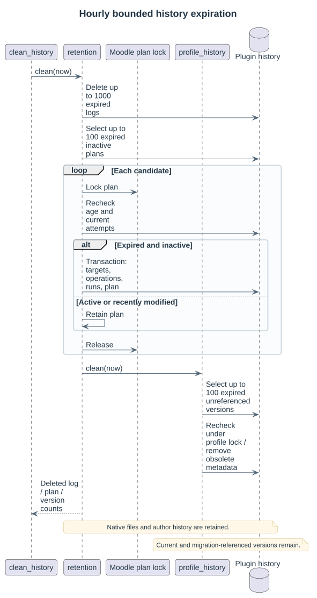

# History and retention

Settings has independent logretentiondays and migrationretentiondays values: defaults are 90 and 365 days. Zero disables expiration. Native form/server validation accepts integers from zero through 36500.

The hourly clean_history task removes at most 1000 old logs and 100 expired plans per invocation. Plan age uses creation time; active queued/running attempts and recently modified attempts keep their plan. The task rechecks eligibility under the plan lock, then transactionally removes target bindings, operations, attempts and the plan. Native course activities/files, profile revisions and author attribution/origin history are retained.

Plan timecreated/id and run planid/state/timemodified indexes support expiration selection. Operation plan/source-course/source-module indexes support whole-group inclusion across review pages. History tables use paginated bounded queries; file review pages never render the complete migration.

Profile deletion is separate from retention. It disables and marks the profile deleted so normal search, editing and export omit it; retained immutable revisions still explain existing plans. Queued/running work prevents disabling or deleting its profile. Log records profile and selection actions through the ordinary log service.

See [schema](05-data-model.md), [migration](06-migrations.md) and [log](12-log-and-upgrade.md).
