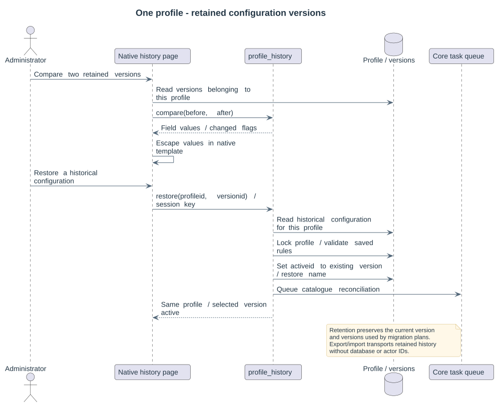

# Profile version history

A profile has one UUID and one current configuration. Saving retains earlier configurations under that same profile; versions are not separate profiles. The history icon in the profile row and Version history action in the editor footer open a bounded history with 10/25/50 page sizes.

The history compares two retained versions side by side by configuration field. Changed fields are highlighted; Show only changes excludes unchanged fields. Values are escaped, including expressions and embedded markup. Each row can compare its version with the current configuration. Restoration creates a new current version using the selected historical content, without changing the profile identity or overwriting earlier history. Native capability checks and session keys protect restoration.

## Retention

Site settings control version age in days and the maximum number of versions per profile. Zero disables that particular limit. Moodle cron removes at most 100 eligible versions per cleanup invocation. The current version and any version referenced by a retained migration plan are always protected, even when this makes the retained count exceed the configured maximum. Profile locks serialize cleanup with saving and restoration. Expiring a version removes only its obsolete catalogue metadata and configuration, never teaching files or original attribution.

## Portable history

Selected/all export produces a `multipicker-profiles` version 2 JSON bundle. Each profile contains its enabled state, current version number and all retained versions, including configuration, version number and creation time. Database IDs and technical user IDs are omitted. Import validates every version before writing, creates one independent profile identity per bundle entry, preserves version numbers and dates, marks the imported current version and queues catalogue rebuilding. The importing user is recorded as the local technical actor.

The native upload accepts up to 16 MB, 500 profiles and 5,000 total historical versions. Legacy version 1 bundles and individual configuration documents remain supported. An import never overwrites another site's existing profile by matching its name. Category and section IDs in historical advanced documents remain site-specific. Exported profiles do not include migration plans, native files or original-author records.

Migration plans keep their reviewed configuration/version. Restoring or changing a profile does not rewrite those snapshots; execution still refuses a plan whose approved profile version no longer matches. See [migration rules](06-migrations.md) and [configuration](04-configurable-rules.md).
