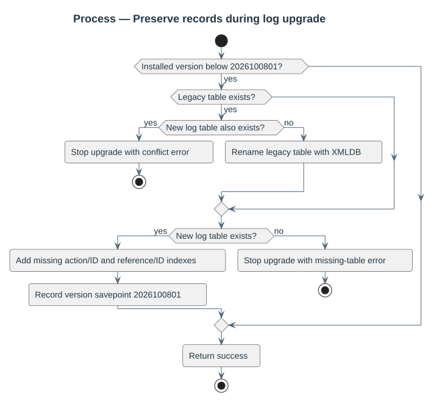
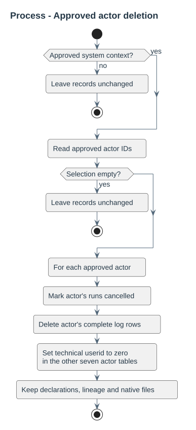
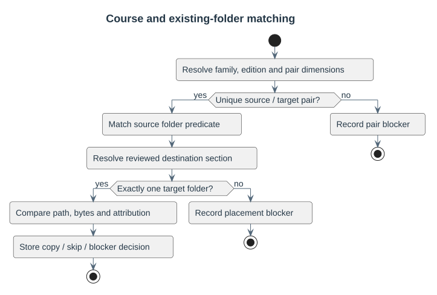
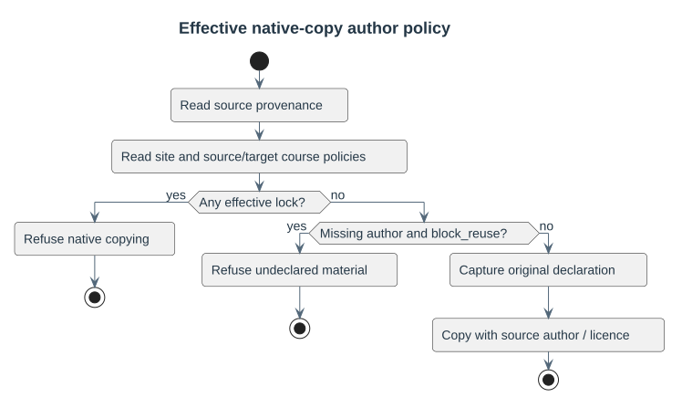
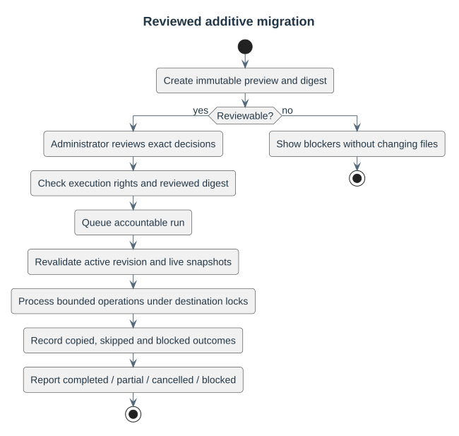
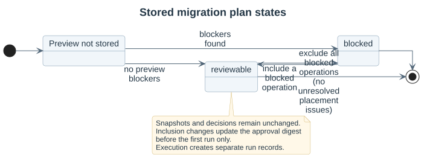
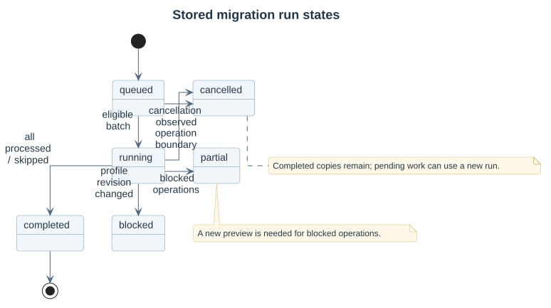
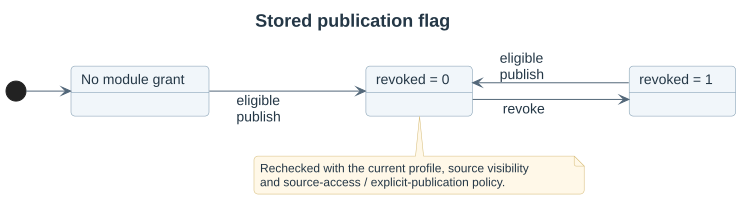
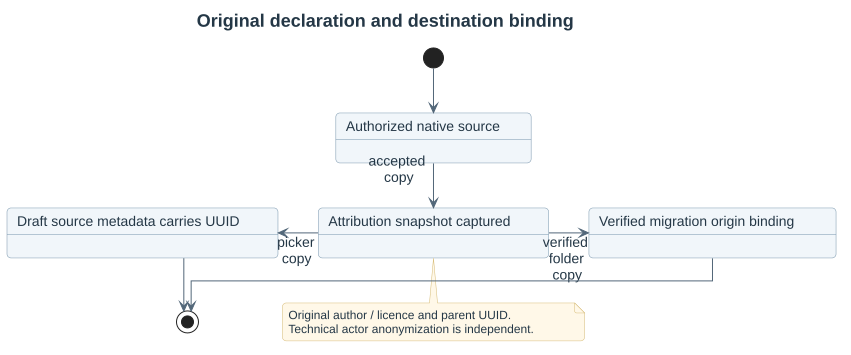

# Processes and stored states

Process diagrams describe decisions. State diagrams describe persisted records; they do not add conceptual review states that the schema does not store.

Individual and approved multi-user deletion share the same actor scope. See the [privacy explanation](../../14-privacy.md) for system-wide deletion and native storage boundaries.

## Stored lifecycles

A preview stores `reviewable` or `blocked`. Reviewing/executing does not mutate its immutable document. A changed revision blocks the attempt; changed source/destination snapshots block affected operations.

Cancellation stops at operation boundaries. Completed copies remain; a new accountable run on the unchanged plan addresses pending operations. Blocked operations require a new reviewed preview.
