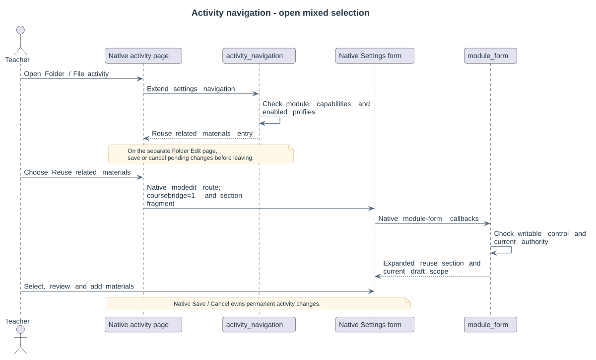
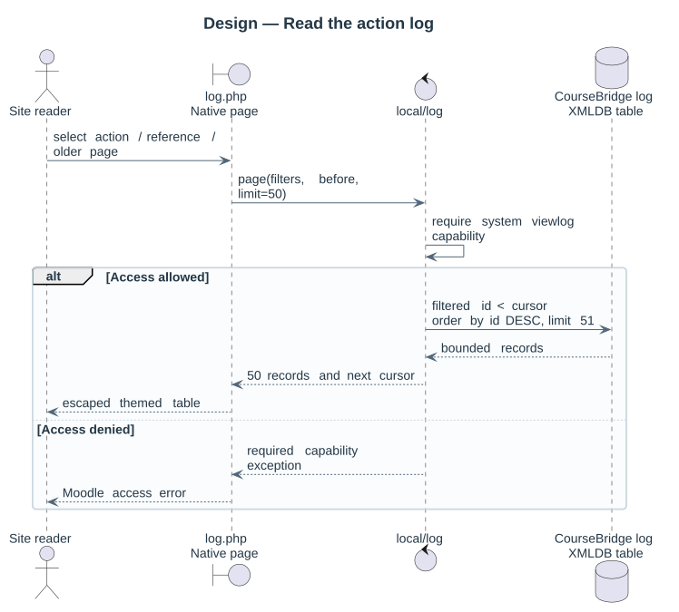
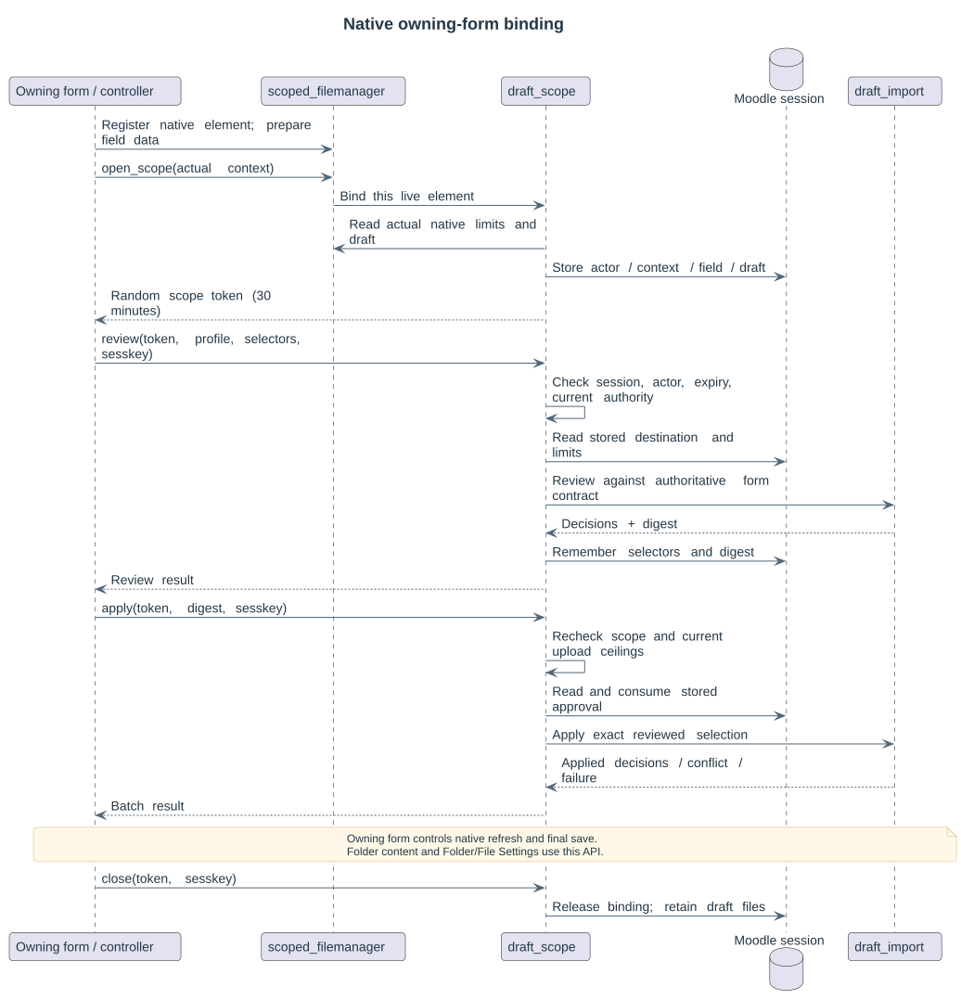
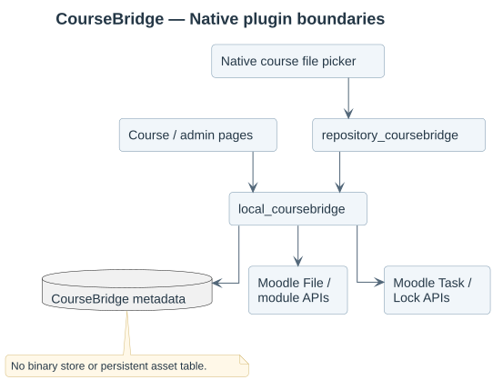
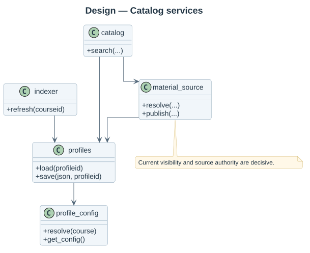
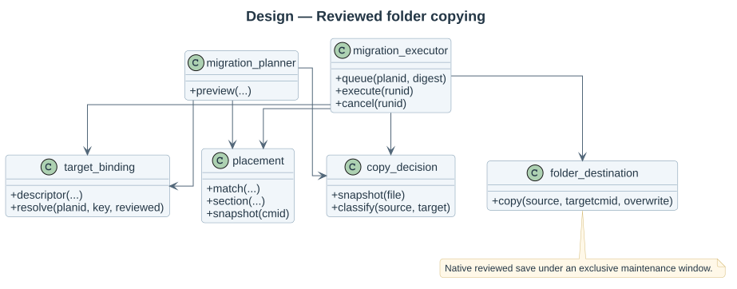
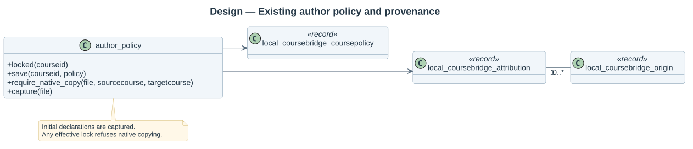

# Design views

The [activity navigation entry](../../19-activity-navigation.md) opens the supported native Settings workflow:

The internal [draft batch service](../../15-draft-batches.md) has a separate sequence:

Explicit owning forms bind their native controls through the [session scope API](../../16-native-form-scope.md):

The native Folder Settings consumer has its own [screen contract](../../17-folder-selection.md):

The native File consumer retains its [main-file choice](../../18-resource-selection.md):

Installed table details are in the [database document](../../05-data-model.md). Each [use case](../requirements/use-cases/README.md) embeds its own design sequence. Shared integrations are described in [architecture](../../03-architecture.md).
