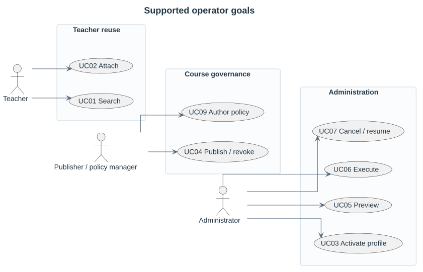
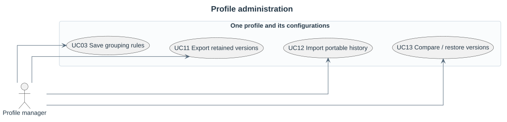

# Context and supported user goals

Requirements diagrams identify user goals. Shared authorization checks are constraints on those goals.

The [individual catalogue](use-cases/README.md) contains each step-by-step conversation and its sequence. Persistent states are documented separately in [behavior](../behavior/README.md).
