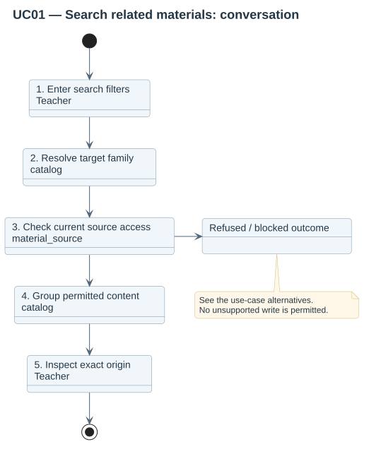

# UC01 — Search related materials

| Attribute | Behavior |
|---|---|
| Primary actor | Teacher |
| Goal | Find authorized teaching files without duplicate content results. |
| Preconditions | The actor has browse authority in a course editing context and an enabled profile exists. |
| Result | A page of permitted content groups and their origins is shown. No course files are written. |

## Step-by-step conversation

[PlantUML source](../../../diagrams/requirements/use-case-details/uc01-search-materials.puml).

| Step | Responsibility | Action |
|---|---|---|
| 1 | Teacher | Opens the catalog or repository and enters filters. |
| 2 | catalog | Resolves the active profile and target family. |
| 3 | material_source | Checks current source eligibility and access for matching occurrences. |
| 4 | catalog | Groups permitted matches by content and completes a cursor page. |
| 5 | Teacher | Inspects source editions and author declarations. |

## Alternative outcomes

- Unknown family returns an empty scoped result.
- Hidden, restricted or revoked origins are excluded before grouping.
- Identical bytes retain distinct origin declarations; no canonical author is invented.

## Design sequence

[Sequence source](../../../diagrams/design/sequences/uc01-search-materials.puml). Current collaborators: catalog, profiles, profile_config, material_source.

[All supported use cases](README.md) · [Stored behavior](../../behavior/README.md).
