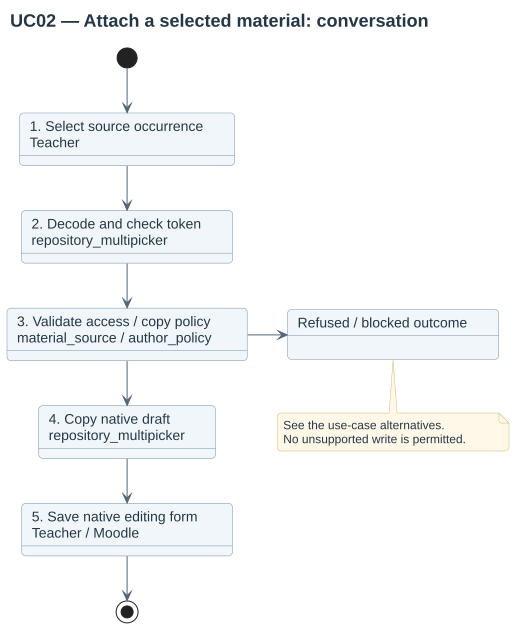
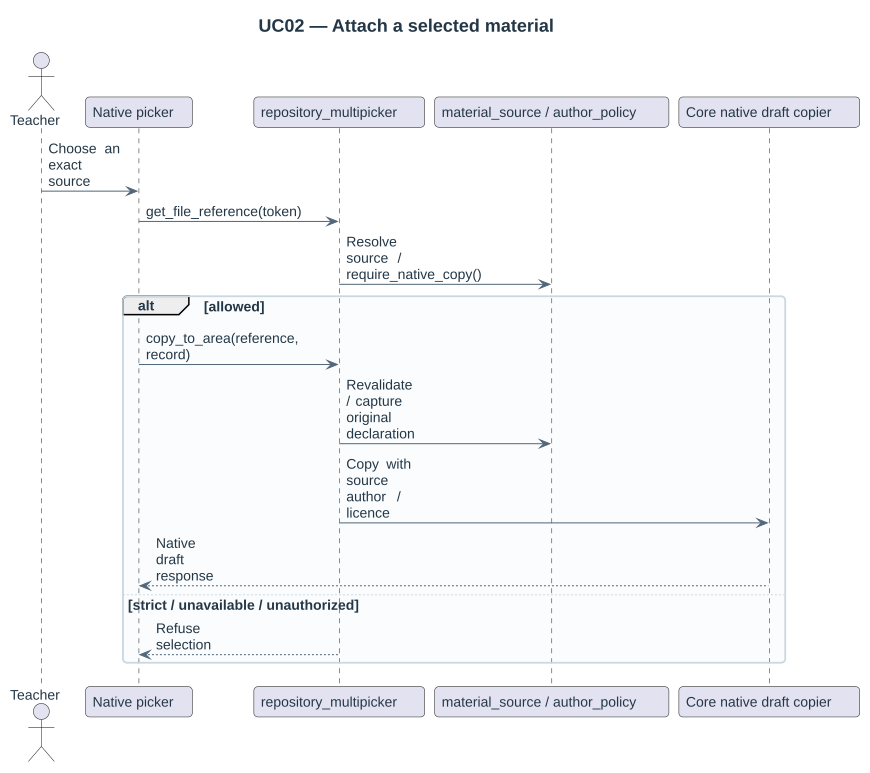

# UC02 — Attach a selected material

| Attribute | Behavior |
|---|---|
| Primary actor | Teacher |
| Goal | Copy one authorized source occurrence through the native course file picker. |
| Preconditions | The actor can reuse materials and edit the target course; the selected source exists. |
| Result | The draft contains the selected material with its initial declaration; native saving owns the resulting course file. |

## Step-by-step conversation

[PlantUML source](../../../diagrams/requirements/use-case-details/uc02-attach-material.puml).

| Step | Responsibility | Action |
|---|---|---|
| 1 | Teacher | Chooses an exact permitted source in the native repository. |
| 2 | repository_multipicker | Decodes the source token and resolves the target context. |
| 3 | material_source / author_policy | Revalidates live source access and author-copy policy. |
| 4 | repository_multipicker | Copies into the native draft with the source author, licence and attribution UUID. |
| 5 | Teacher / Moodle | Saves the course editing form through its native module contract. |

## Alternative outcomes

- Malformed, unavailable or unauthorized sources are refused.
- Strict author policy or required missing author blocks copying.
- Native target file-type and size restrictions still apply.

## Design sequence

[Sequence source](../../../diagrams/design/sequences/uc02-attach-material.puml). Current collaborators: repository_multipicker, material_source, author_policy, core repository draft copier.

[All supported use cases](README.md) · [Stored behavior](../../behavior/README.md).
