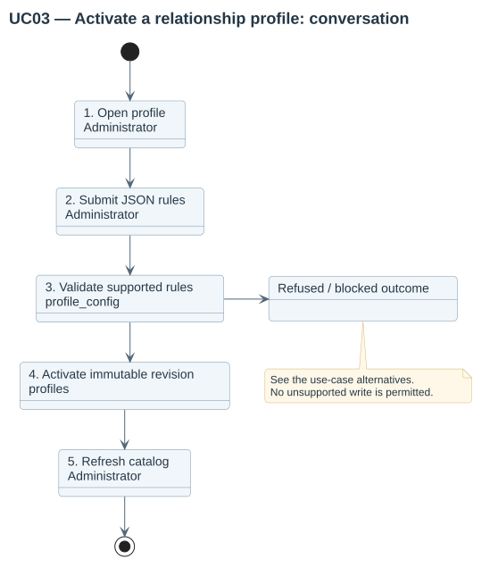

# UC03 — Activate a relationship profile

| Attribute | Behavior |
|---|---|
| Primary actor | Administrator |
| Goal | Configure related courses and placement using a validated immutable JSON revision. |
| Preconditions | The actor has manageprofiles authority. |
| Result | The active profile points to a new immutable revision; no course materials change. |

## Step-by-step conversation

[PlantUML source](../../../diagrams/requirements/use-case-details/uc03-configure-profile.puml).

| Step | Responsibility | Action |
|---|---|---|
| 1 | Administrator | Opens a named profile or creates a new profile. |
| 2 | Administrator | Edits guided fields, or advanced JSON, and optionally previews unsaved rules. |
| 3 | profile_config | Validates supported fields, named captures and bounded patterns. |
| 4 | profiles | Stores and activates a revision under a lock and transaction. |
| 5 | Administrator | Refreshes materials or waits for scheduled reconciliation. |

## Alternative outcomes

- Invalid JSON, unsupported options or invalid regexes reject activation.
- Ambiguous course parser results block identity resolution.
- Existing migration snapshots retain their original revision.

## Design sequence

[Sequence source](../../../diagrams/design/sequences/uc03-configure-profile.puml). Current collaborators: profile_config, profiles, indexer, reconcile_catalog.

[All supported use cases](README.md) · [Stored behavior](../../behavior/README.md).
