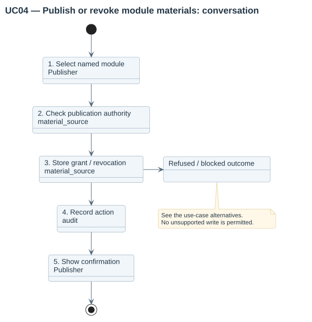
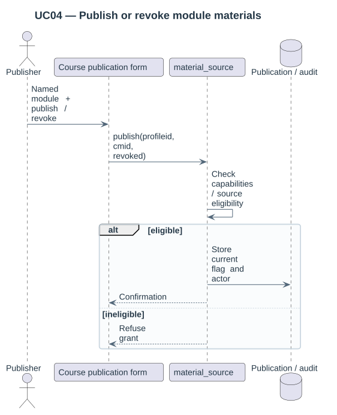

# UC04 — Publish or revoke module materials

| Attribute | Behavior |
|---|---|
| Primary actor | Publisher |
| Goal | Grant or revoke historical reuse for an eligible public activity provider. |
| Preconditions | The actor can publish and manage activities in the source course; the profile uses explicit family publication. |
| Result | The explicit module publication flag has the requested value. |

## Step-by-step conversation

[PlantUML source](../../../diagrams/requirements/use-case-details/uc04-publish-materials.puml).

| Step | Responsibility | Action |
|---|---|---|
| 1 | Publisher | Selects a named activity with a declared public material provider in the course page. |
| 2 | material_source | Checks source type, visibility, section restrictions and publication authority. |
| 3 | material_source | Stores the grant or revocation flag and action actor. |
| 4 | log | Records the publication action. |
| 5 | Publisher | Receives confirmation and continues browsing. |

## Alternative outcomes

- Hidden/restricted or unsupported source modules cannot be granted publication.
- Revocation prevents subsequent selection even if a previous listing is open.
- Revocation does not remove independent copies.

## Design sequence

[Sequence source](../../../diagrams/design/sequences/uc04-publish-materials.puml). Current collaborators: material_source, profiles, log.

[All supported use cases](README.md) · [Stored behavior](../../behavior/README.md).
