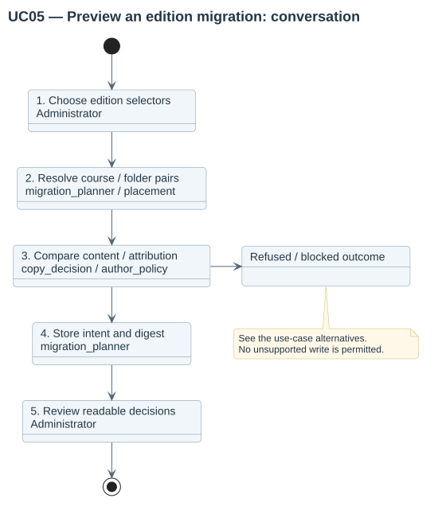

# UC05 — Preview a configured migration

| Attribute | Behavior |
|---|---|
| Primary actor | Administrator |
| Goal | Review exact file decisions without changing native materials. |
| Preconditions | The actor has planmigration authority and can manage the destination courses. |
| Result | A reviewable or blocked immutable preview exists; native files are unchanged. |

## Step-by-step conversation

[PlantUML source](../../../diagrams/requirements/use-case-details/uc05-preview-migration.puml).

| Step | Responsibility | Action |
|---|---|---|
| 1 | Administrator | Chooses a profile and an edition or configured capture, then distinct source/destination values; confirms ordinal layout when applicable. |
| 2 | migration_planner / placement | Resolves unique family/dimension course pairs, sections and existing folders. |
| 3 | copy_decision / author_policy | Compares source and target content, paths, declarations and copy policy. |
| 4 | migration_planner | Stores immutable intent, snapshots, decisions and digest. |
| 5 | Administrator | Reviews paginated files and placement issues, searches and saves inclusions or exclusions across pages. |

## Alternative outcomes

- Missing or ambiguous pairs/placements create blockers.
- Identical-byte targets with conflicting attribution are blocked.
- Unsupported strict copying blocks the initial plan.
- Selection changes update the approval digest before the first run; unresolved placement issues remain blockers.

## Design sequence

[Sequence source](../../../diagrams/design/sequences/uc05-preview-migration.puml). Current collaborators: migration_planner, placement, material_source, copy_decision, author_policy.

[All supported use cases](README.md) · [Stored behavior](../../behavior/README.md).
