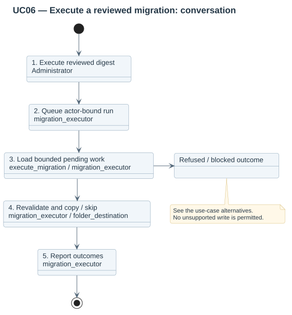
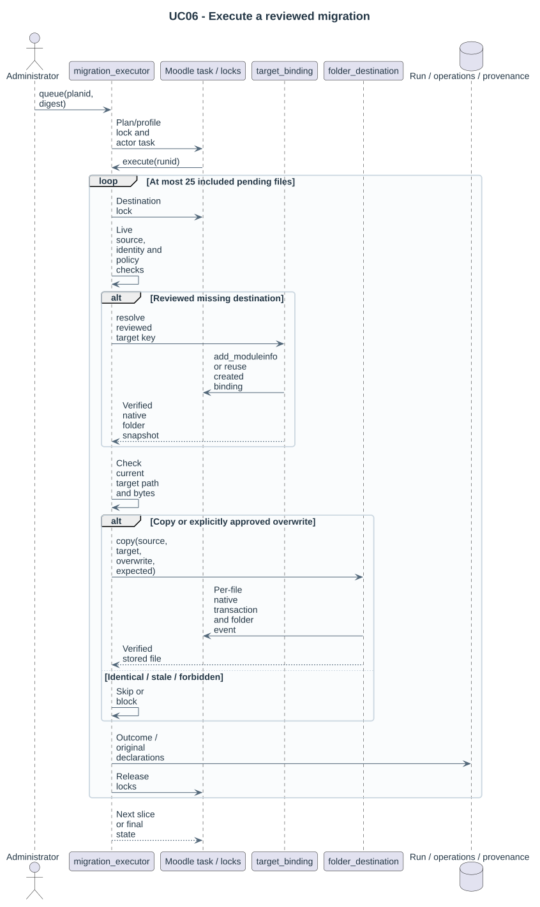

# UC06 — Execute a reviewed migration

| Attribute | Behavior |
|---|---|
| Primary actor | Administrator |
| Goal | Apply reviewed additive copies into existing folders. |
| Preconditions | The plan is reviewable and its digest matches; the actor has execution rights and confirms the reviewed destinations. The site remains available. |
| Result | The attempt reports completed, partial or blocked state; source and unrelated destination files remain. |

## Step-by-step conversation

[PlantUML source](../../../diagrams/requirements/use-case-details/uc06-execute-migration.puml).

| Step | Responsibility | Action |
|---|---|---|
| 1 | Administrator | Executes the reviewed digest. |
| 2 | migration_executor | Queues a run under the acting user's identity. |
| 3 | execute_migration / migration_executor | Processes at most 25 operations per slice under destination locks. |
| 4 | migration_executor / folder_destination | Revalidates the active revision, live access and snapshots; copies each path through the File API or skips identical content. |
| 5 | migration_executor | Records outcomes, provenance and run state; continues pending work. |

## Alternative outcomes

- Changed profile revision blocks the run.
- Stale source, placement or policy blocks the affected operation.
- Already-present identical files are skipped; unaffected operations continue.

## Design sequence

[Sequence source](../../../diagrams/design/sequences/uc06-execute-migration.puml). Current collaborators: migration_executor, material_source, author_policy, folder_destination, log, Moodle Task/Lock.

[All supported use cases](README.md) · [Stored behavior](../../behavior/README.md).
