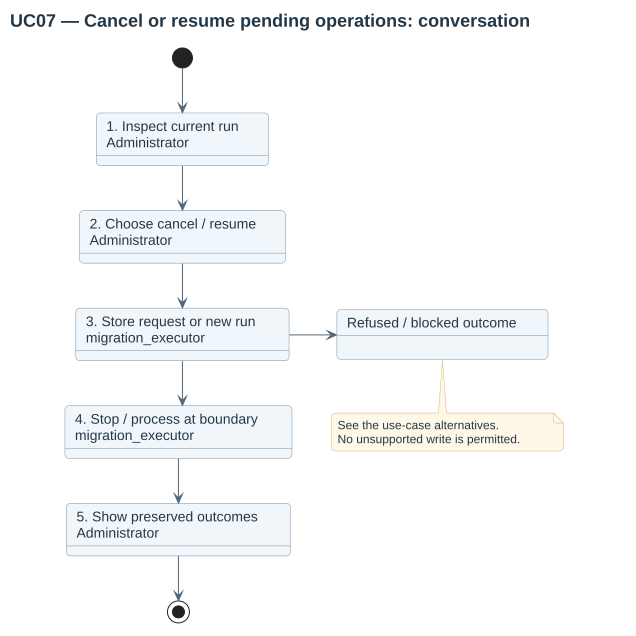
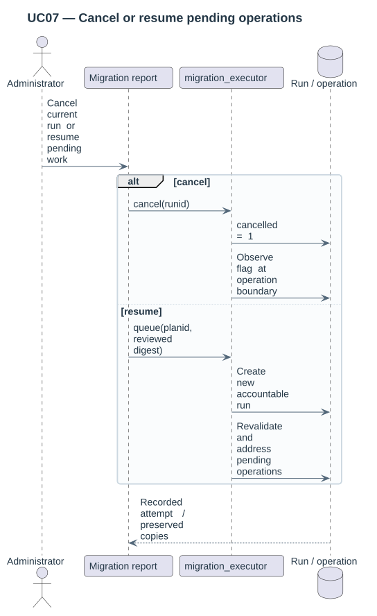

# UC07 — Cancel or resume pending operations

| Attribute | Behavior |
|---|---|
| Primary actor | Administrator |
| Goal | Stop an attempt safely or submit remaining pending operations under the same reviewed intent. |
| Preconditions | The actor has execution authority; the plan and run exist. |
| Result | Cancelled work is retained in the report, or a new attempt addresses eligible pending operations. |

## Step-by-step conversation

[PlantUML source](../../../diagrams/requirements/use-case-details/uc07-resume-or-cancel.puml).

| Step | Responsibility | Action |
|---|---|---|
| 1 | Administrator | Checks the current attempt and pending operations. |
| 2 | Administrator | Requests cancellation or executes the unchanged reviewed plan again. |
| 3 | migration_executor | Stores cancellation or creates an accountable run. |
| 4 | migration_executor | Stops at an operation boundary or revalidates pending work. |
| 5 | Administrator | Reads the attempt result; completed copies remain available. |

## Alternative outcomes

- Cancellation does not reverse completed copies.
- Blocked operations need a new reviewed preview.
- A changed profile or stale snapshots still block subsequent work.

## Design sequence

[Sequence source](../../../diagrams/design/sequences/uc07-resume-or-cancel.puml). Current collaborators: migration_executor, execute_migration, Moodle Task/Lock.

[All supported use cases](README.md) · [Stored behavior](../../behavior/README.md).
