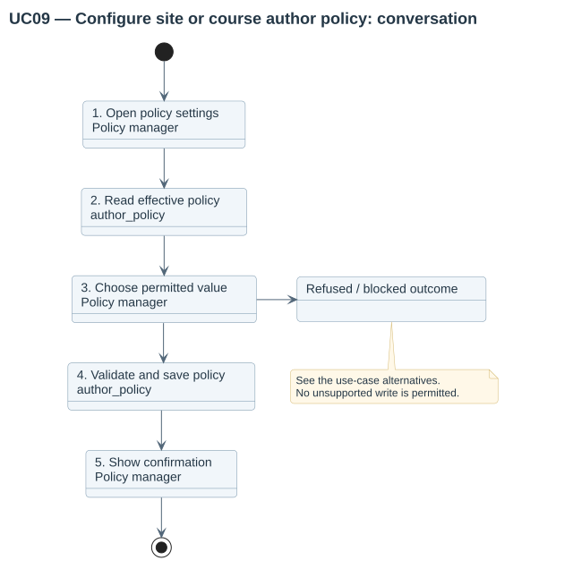

# UC09 — Configure site or course author policy

| Attribute | Behavior |
|---|---|
| Primary actor | Policy manager |
| Goal | Select author preservation and allowed tighter course policy. |
| Preconditions | The actor has the site configuration or course managecoursepolicy capability. |
| Result | The effective policy follows site precedence and source/target locks. |

## Step-by-step conversation

[PlantUML source](../../../diagrams/requirements/use-case-details/uc09-configure-material-policy.puml).

| Step | Responsibility | Action |
|---|---|---|
| 1 | Policy manager | Opens site settings or the course Material policy page. |
| 2 | author_policy | Displays the effective inherited source/site/course rule. |
| 3 | Policy manager | Selects a permitted site value or inherit/stricter course value. |
| 4 | author_policy | Validates the course override and stores policy/actor/revision. |
| 5 | Policy manager | Receives confirmation; later selections and jobs read the current rule. |

## Alternative outcomes

- Course overrides disabled at the site cannot be saved.
- A course cannot relax the site rule.
- Strict native copying is refused because later native editing protection is unavailable.

## Design sequence

[Sequence source](../../../diagrams/design/sequences/uc09-configure-material-policy.puml). Current collaborators: author_policy, Moodle admin settings, coursepolicy records, audit.

[All supported use cases](README.md) · [Stored behavior](../../behavior/README.md).
