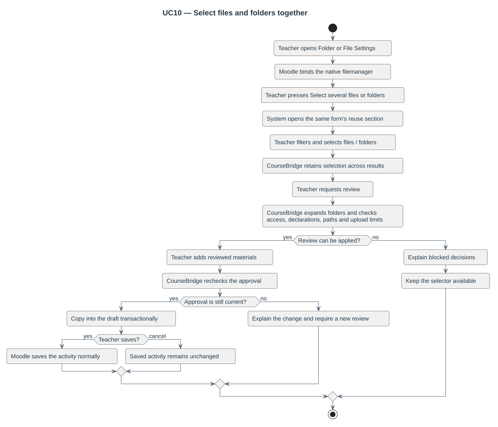
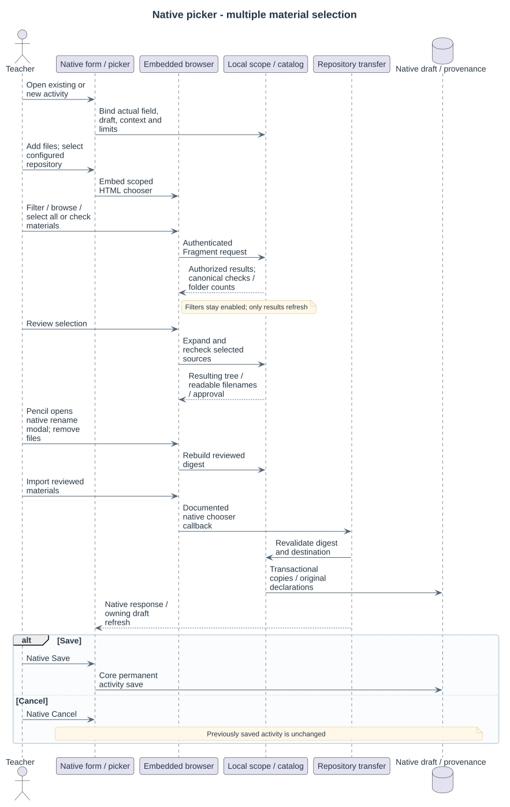
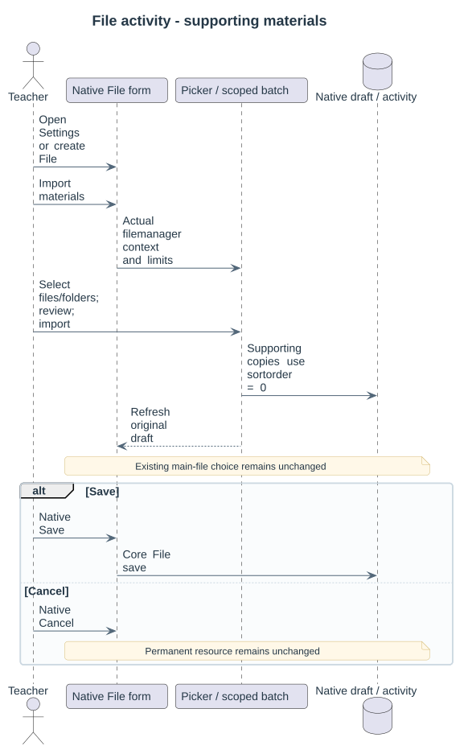

# UC10 — Select files and folders together

| Attribute | Behavior |
|---|---|
| Primary actor | Teacher editing a Folder or File activity |
| Goal | Review a mixed selection and populate the current native draft |
| Preconditions | Enabled profile, authorized sources, writable native Folder/File settings form and permitted author policy |
| Result | Copied draft files retain original declarations and relative paths; native Save/Cancel owns permanent storage |

| Step | Responsibility | Action |
|---|---|---|
| 1 | Teacher | Opens Folder or File Settings and the reuse section |
| 2 | Moodle / module_form | Binds the real filemanager and displays authorized choices |
| 3 | Teacher | Filters and selects files and real folders across results |
| 4 | draft_scope / draft_import | Expands eligible descendants and reviews current limits, declarations and conflicts |
| 5 | Teacher | Checks the review and adds the approved selection |
| 6 | CourseBridge | Revalidates approval and copies transactionally into the draft without changing its main file |
| 7 | Teacher / Moodle | Saves normally or cancels without changing the activity |

Empty/oversized selections, stale approvals, revoked access, strict author policy, conflicting paths and incompatible native limits are explained. A rejected review leaves the selector available. Search filters do not restrict a selected folder's descendants.

[Detailed screen contract](../../../17-folder-selection.md) · [Use-case catalogue](README.md).

File activities preserve their main-file choice: [File screen contract](../../../18-resource-selection.md).

