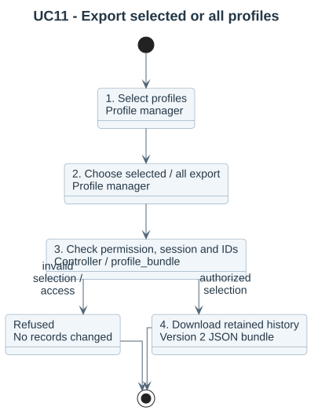
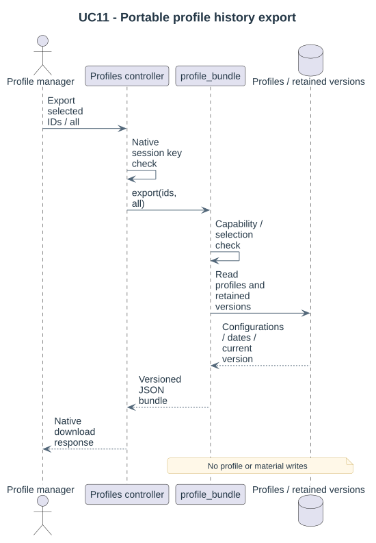

# UC11 - Export selected or all profiles

The profile manager requires `local/multipicker:manageprofiles`. Export is read-only and contains active rule documents, without database identities, material files or historical records.

1. Open Profiles and select individual cards or Select all.
2. Choose Export selected, or Export all profiles regardless of the current selection.
3. The controller checks the native session key; `profile_bundle::export` checks capability and selected IDs.
4. Active configurations are packaged as a versioned JSON bundle and downloaded.

An empty explicit selection or an unknown selected profile is refused. No profile revision changes. Review site-specific category IDs and section mappings before importing elsewhere.

[Conversation source](../../../diagrams/requirements/use-case-details/uc11-export-profiles.puml) · [Sequence source](../../../diagrams/design/sequences/uc11-export-profiles.puml) · [Use-case catalogue](README.md).
