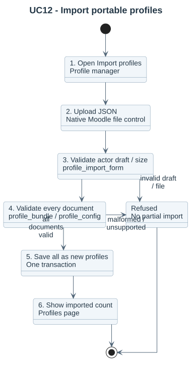
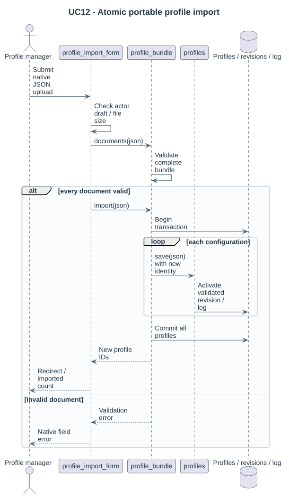

# UC12 - Import portable profiles

The profile manager requires `local/multipicker:manageprofiles`. Import creates independent profiles with new identities and validated active revisions. Existing profiles remain unchanged.

1. Open Profiles, then Import profiles.
2. Upload a JSON bundle or a single existing profile document through Moodle's native file control.
3. The native form checks the actor-owned draft, file extension and 1 MB limit.
4. `profile_bundle` validates every document, the bundle version and the maximum of 500 profiles before writing.
5. One transaction saves all new profiles through `profiles::save`.
6. Return to Profiles with the imported count and new table rows.

Malformed or unsupported documents are refused without a partial import. Capability/session failures refuse the action. Cancel leaves profiles unchanged. Site-specific category IDs, section mappings and publication rules remain explicit configuration values.

[Conversation source](../../../diagrams/requirements/use-case-details/uc12-import-profiles.puml) · [Sequence source](../../../diagrams/design/sequences/uc12-import-profiles.puml) · [Use-case catalogue](README.md).
