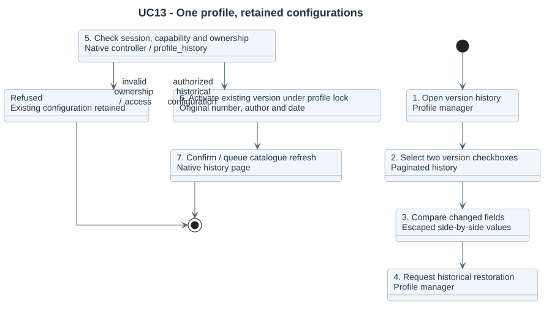

# UC13 - Compare and restore profile configurations

The profile manager requires `local/multipicker:manageprofiles`. One profile owns its current configuration and retained versions; restoring an earlier configuration activates that existing version under the same identity.

1. Open Version history from the profile row, or Version history from the editor.
2. Browse bounded pages of 10, 25 or 50 retained versions.
3. Select two version checkboxes and press Compare; alternatively open a row’s comparison with the current version.
4. Compare escaped field values; Show only changes hides unchanged values.
5. Choose Restore this version for a historical configuration.
6. The controller checks the session key and the service checks capability and ownership.
7. Under the profile lock, set the selected existing version current, retain its content/author/date and queue catalogue reconciliation.
8. Return to the same profile history with a confirmation.

A version belonging to another profile is refused. Deleted profiles cannot be restored. Invalid historical rules and lock failures leave the existing configuration unchanged. Retention protects current and migration-referenced versions; expiring a configuration never deletes native teaching files. Existing migration snapshots remain unchanged and require their original approved profile version before execution.

[Conversation source](../../../diagrams/requirements/use-case-details/uc13-profile-history.puml) · [Sequence source](../../../diagrams/design/sequences/profile-history.puml) · [Version history](../../../25-profile-version-history.md).
